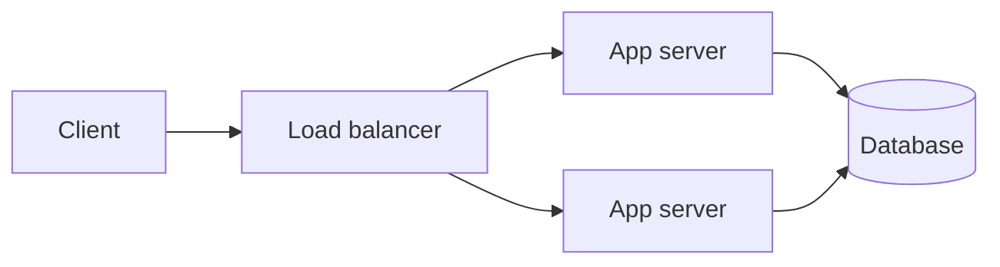

# 01 · What System Design Is & How to Approach It

A program running on your laptop has one CPU scheduler, one memory space, and one disk.
If it crashes, it crashes completely, and you restart it. The moment a program's work is
spread across several machines, three new facts appear:

1. **The network is slow and unreliable** compared with memory. Messages get delayed,
   duplicated, reordered, or lost.
2. **Parts fail independently.** One server can be down while the rest are up, and the
   rest often cannot tell "down" apart from "slow".
3. **There is no shared clock or shared memory.** Two machines can disagree about what
   happened first.

System design is the discipline of arranging components — servers, databases, caches,
queues, networks — so that a system meets its requirements *despite* those facts, at a
cost someone is willing to pay. It is less about knowing product names and more about
reasoning from requirements to structure.

## Requirements come first

Almost every weak design starts by drawing boxes before understanding the problem. There
are two kinds of requirement, and you need both.

**Functional requirements** describe what the system does:

- "A user can upload a photo and share it with followers."
- "A driver's location updates on the rider's map."

**Non-functional requirements** describe how well it must do it:

| Quality | Example question to ask |
|---|---|
| Scale | How many users? Requests per second at peak? Data growth per year? |
| Latency | What response time is acceptable, and at which percentile (p50, p99)? |
| Availability | Is a few minutes of downtime a month acceptable? A few seconds? |
| Consistency | If a user writes something, must they (and others) see it immediately? |
| Durability | Can we ever lose accepted data? What about the last few seconds of it? |
| Cost | Is this a startup on a small budget or a platform with millions in spend? |
| Compliance | Personal data, payment data, data residency rules? |

Non-functional requirements drive almost all the interesting decisions. A photo-sharing
app for 1,000 users is a single server with a database. The same features for 100
million users demand CDNs, object storage, sharded metadata, and asynchronous
processing. The functional spec barely changed; the numbers did.

## A repeatable approach

Use the same five steps whether you are in an interview or writing a design doc at work.

### Step 1 — Clarify scope

Restate the problem and decide what is *out* of scope. "Design Twitter" is far too big.
"Users post short text messages; followers see them in a home timeline; we skip search,
ads, and DMs" is designable.

### Step 2 — Estimate

Turn the scale requirements into numbers: requests per second, bytes stored per day,
bandwidth. Lesson 3 covers the arithmetic. The goal is to discover whether this is a
"one database is fine" problem or a "we must partition" problem.

### Step 3 — Define the interface and data model

Write down the main API calls and the main entities:

```text
POST /messages            {text}            -> {message_id}
GET  /timeline?cursor=... -> [{message_id, author, text, created_at}, ...]

User(user_id, name, created_at)
Message(message_id, author_id, text, created_at)
Follow(follower_id, followee_id)
```

This is where ambiguity surfaces. Does a timeline show messages in time order or ranked?
Can messages be edited? Each answer changes the design.

### Step 4 — High-level design

Draw the request path for the most important operations. Start simple:



Then trace each operation through it and ask what happens at the estimated load.

### Step 5 — Deep dives and failure modes

Pick the two or three hardest parts — usually the data layer and whichever path has the
highest load — and go deep. For each component ask: what happens if it is slow? If it
is down? If it receives ten times the traffic? This is where caches, replicas, queues,
and partitions earn their place.

## Worked example: a tiny pastebin

Prompt: "Users paste text and get a link; anyone with the link can read it."

**Scope.** Create and read pastes. Pastes are immutable. Optional expiry. No accounts,
no editing, no search.

**Estimate.** Suppose 100,000 new pastes per day and a 10:1 read-to-write ratio.

```text
writes: 100,000 / 86,400 s ≈ 1.2 per second (call it ~5/s at peak)
reads:  ~12 per second average, maybe ~50/s at peak
size:   average paste 10 KB -> 100,000 × 10 KB = 1 GB per day ≈ 365 GB per year
```

These numbers are small. One modest server and one database handle them comfortably.
The only thing that grows is storage, and that grows slowly.

**Interface.**

```text
POST /pastes {content, ttl_seconds?} -> {id}
GET  /pastes/{id}                    -> content (or 404 if missing/expired)
```

**Design.** An app server writes paste content to a database table
`pastes(id, content, created_at, expires_at)`. Reads are primary-key lookups. A nightly
job deletes expired rows (or reads simply check `expires_at` and a cleanup job runs
lazily).

**Deep dive.** The interesting question is the ID. Sequential integers leak how many
pastes exist and let anyone enumerate them. A random 8-character base-62 ID has
62^8 ≈ 2.2 × 10^14 possibilities, so guessing a valid one is impractical at this scale,
and collisions can be detected on insert with a unique constraint and a retry.

That is a complete, honest design. Notice what we did *not* add: no cache, no queue, no
sharding. Nothing in the numbers asked for them. Adding them anyway would be cost and
complexity without benefit.

## How It Actually Works

Why do distributed systems need a discipline of their own? Consider a single operation:
"charge the card, then mark the order paid". On one machine, you can wrap both in a
local transaction. Across two services connected by a network, the caller sends a
request and waits. Three outcomes are possible:

1. A success response arrives — the charge happened.
2. An error response arrives — it probably did not happen.
3. **Nothing arrives before the timeout.**

Case 3 is the heart of distributed systems. The request may have been lost before
reaching the payment service, or processed with the response lost on the way back, or
still be in progress. The caller cannot distinguish these. Every technique later in this
course — idempotency keys, retries with backoff, consensus, sagas — exists because of
that third outcome.

Similarly, "availability" is not a vague virtue; it is arithmetic. If a request must
pass through three components in series, each available 99.9% of the time and failing
independently, the path is available about 0.999³ ≈ 99.7% of the time. Putting two
redundant copies of a component in parallel, where either can serve, raises its
availability to 1 − (0.001)² = 99.9999% — *if* failures are truly independent and
failover works. Designs improve availability by removing serial dependencies and adding
parallel redundancy, and they lose it through shared hidden dependencies (the same
power supply, the same config push, the same DNS provider).

## Common mistakes

- **Designing before clarifying.** Two minutes of questions can remove half the
  complexity from a design.
- **Adding components by reflex.** "Put Redis in front" is not a design decision unless
  you can say which read path it speeds up and what staleness it introduces.
- **Ignoring the read/write ratio.** A read-heavy system and a write-heavy system with
  the same total traffic need very different architectures.
- **Only designing the happy path.** Reviewers and interviewers care most about what
  happens when things fail.
- **Treating numbers as precise.** Estimates are for orders of magnitude. 1.2 or 1.5
  writes per second makes no difference; 10 vs 10,000 does.

## Exercise

Pick an app you use daily (a to-do list, a food-delivery tracker, a group chat). Write:

1. Three functional requirements and three things you would explicitly leave out.
2. Five non-functional requirements with a concrete number or level for each.
3. A rough estimate of writes/second, reads/second, and storage per year, stating every
   assumption.
4. A one-paragraph judgement: is this a single-server problem, or does something in your
   numbers force a distributed design? Which number decided it?
