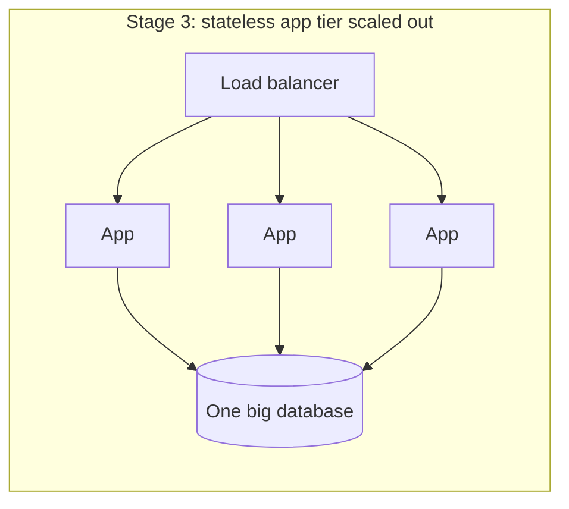

# 04 · Vertical vs Horizontal Scaling

When a system runs out of capacity, you have two basic moves: make the machine bigger
(**scale up**, vertical) or add more machines (**scale out**, horizontal). Engineers
often treat horizontal scaling as automatically superior. It is not. It is more
flexible at the top end and more complicated everywhere else.

## Scaling up

Buy or rent a machine with more CPU cores, more memory, faster disks, a faster network.

**Advantages**

- No code changes. The program that ran on 4 cores runs on 64.
- No distributed-systems problems: one memory space, local transactions, no network
  partitions between your own components.
- Often surprisingly far-reaching. Large single database servers with hundreds of GB
  or more of RAM can serve very substantial workloads, especially when the working set
  fits in memory.

**Disadvantages**

- **A ceiling.** At some point there is no bigger machine you can buy.
- **Non-linear cost.** The largest instance sizes and specialized hardware tend to cost
  disproportionately more per unit of capacity.
- **Single point of failure.** One machine is one failure domain, and upgrading it
  usually means downtime (or a failover to a standby).

## Scaling out

Run N copies of a component and spread the work between them.

**Advantages**

- Capacity grows (roughly) by adding commodity machines.
- Redundancy: losing one of ten servers loses ~10% of capacity, not 100%.
- Elasticity: add servers for peak hours, remove them afterwards.

**Disadvantages**

- Work must be divisible. Something has to route requests (a load balancer) and the
  servers must not depend on local state.
- Coordination costs appear: shared data needs replication, partitioning, or both.
- More machines means more things failing at any given moment, so failure handling
  becomes routine rather than exceptional.

## The asymmetry: stateless vs stateful tiers

Scaling out is easy for **stateless** components and hard for **stateful** ones.

- **Stateless app servers**: any server can handle any request because all durable
  state is elsewhere. Adding a tenth server is a configuration change.
- **Stateful databases**: the data lives on the machine. Adding a second database
  server means deciding which data goes where (sharding), how copies stay in sync
  (replication), and what a reader sees while they do.

A typical growth path therefore looks like this:

1. One server running app and database.
2. Split the database onto its own (bigger) machine.
3. Scale the app tier horizontally behind a load balancer; keep scaling the database
   vertically.
4. Add read replicas and caches to offload database reads.
5. Only when writes or data size outgrow the largest practical database machine,
   partition the data (Level 2).

## Worked example: when does the database need to be split?

A SaaS product stores customer invoices. Current load: 800 writes/s and 6,000 reads/s at
peak, 2 TB of data, growing 50% per year. The database server is at 60% CPU at peak.

Reasoning:

- Reads dominate 7.5:1. Read replicas or a cache can absorb most read growth without
  touching the write path.
- Writes at 800/s on a single well-tuned relational database are usually manageable;
  the question is headroom. At 50% annual growth, writes reach ~1,800/s in two years.
- Data at 2 TB → ~4.5 TB in two years. That fits on a single machine's storage, though
  backups, index rebuilds, and restores get slower.
- 60% CPU with 50% yearly growth means roughly 90% in a year — beyond comfortable.

A proportionate plan: move reads to replicas now (cheap, reversible), scale the primary
up one size, and start designing a partitioning scheme (probably by customer ID, since
invoices never span customers) to implement within the next year. Sharding now would be
premature; ignoring it would be negligent.

## Making the app tier stateless

Things that commonly sneak state onto app servers, and where to move them:

| Hidden state | Move it to |
|---|---|
| User sessions in memory | Shared session store, or signed tokens |
| Uploaded files on local disk | Object storage |
| In-process caches assumed to be authoritative | Treat as disposable, or use a shared cache |
| Scheduled jobs that run "on the server" | A job scheduler with a lock or a single leader |
| WebSocket connections | Unavoidable — design routing for it (Level 3, lesson 6) |

A quick self-test: could you terminate any app server at a random moment, replace it,
and lose nothing except in-flight requests? If yes, the tier is stateless.

## How It Actually Works

**Why scaling out is not perfectly linear.** Amdahl's Law says that if a fraction *s* of
the work is inherently serial, the maximum speedup from N parallel workers is
1 / (s + (1 − s)/N). With just 5% serial work, even infinite servers top out at 20×.
In web systems the "serial" part is usually a shared resource: one database primary,
one lock, one hot row, one queue partition. Adding app servers past that point only
adds contention on the shared thing.

Worse, coordination can make throughput *fall*. If every server must talk to every other
(for example to invalidate caches or agree on membership), communication grows roughly
with N², and eventually more servers mean more overhead than work. Good horizontally
scalable designs keep the shared, coordinated part tiny and push everything else into
independent units that never talk to each other.

**Why vertical scaling runs out.** CPU clock speeds stopped rising quickly years ago;
bigger machines add cores, not faster cores. Software must be parallel to use them, and
memory bandwidth, lock contention inside the database, and single-threaded parts of
the workload become limits long before the core count does.

## Common mistakes

- **Sharding too early.** It permanently complicates queries, transactions, and
  operations. Exhaust caching, replicas, indexing, and a bigger machine first — as long
  as the growth curve says you have time.
- **Assuming the app tier is stateless** without checking for local files, sessions, or
  cron jobs.
- **Autoscaling the app tier into a fixed database.** Twice the app servers can mean
  twice the database connections and a worse outage.
- **Ignoring the cost curve** of the largest instance types.

## Exercise

You run a forum on one server: app + PostgreSQL, 200 requests/s at peak, CPU at 85%.
User uploads (avatars, attachments) are saved to `/var/uploads` on that server and
sessions are stored in process memory.

1. List every change needed before you can run three app servers behind a load balancer.
2. Sketch the architecture after those changes.
3. Decide whether the database should be scaled up or out first, using a growth
   assumption you state explicitly.
4. Use Amdahl's Law: if 10% of each request's time is spent holding a global lock in the
   database, what is the maximum throughput gain from adding app servers?
