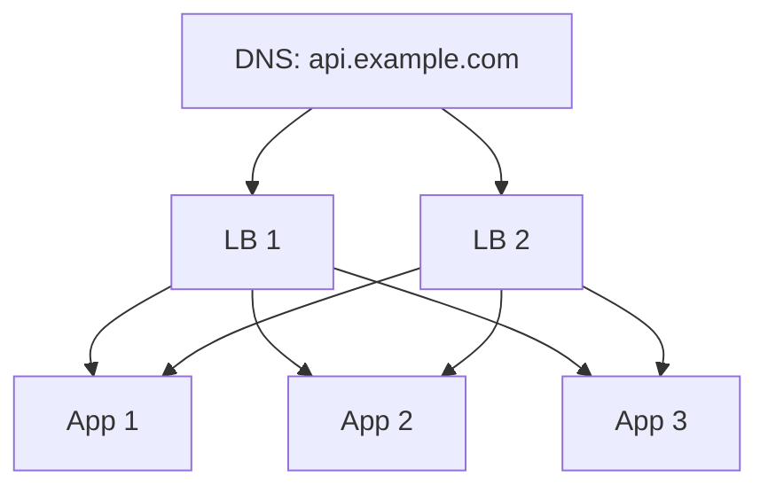

# 05 · Load Balancing

A load balancer sits in front of a pool of servers and decides which one receives each
request or connection. It is what turns "we have ten app servers" into one service with
one address. It also quietly handles failure: when a server dies, the balancer stops
sending it traffic.

## Layer 4 vs layer 7

**L4 (transport-level) balancers** see TCP/UDP connections: source and destination IPs
and ports. They forward packets or connections without reading the HTTP inside.

- Very fast and cheap per connection; protocol-agnostic (databases, custom protocols).
- Cannot route by URL path or header, cannot retry a failed HTTP request, and balance
  per *connection*, not per request. With long-lived HTTP/2 or gRPC connections, one
  connection can carry many requests, so L4 balancing can be very uneven.

**L7 (application-level) balancers** terminate the connection, parse HTTP, and open
their own connections to backends.

- Can route `/api/*` to one pool and `/static/*` to another, route by header or cookie,
  terminate TLS, add headers, retry idempotent requests, and balance per request.
- Cost more CPU, and they see decrypted traffic, which has security implications.

Most web architectures use L7 balancing (reverse proxies such as NGINX, HAProxy, Envoy,
or cloud-managed equivalents) at the front, sometimes with L4 balancing in front of
*them* for raw scale.

## Balancing algorithms

| Algorithm | How it picks | Good for | Weak when |
|---|---|---|---|
| Round robin | Next server in order | Equal servers, similar requests | Requests vary widely in cost |
| Weighted round robin | Proportional to weight | Mixed machine sizes | Weights go stale |
| Least connections | Fewest open connections | Variable request duration | Many balancers each see partial counts |
| Least response time / EWMA | Fastest recently | Heterogeneous latency | Needs good measurements |
| Power of two choices | Pick 2 at random, choose the less loaded | Large pools, many balancers | — generally robust |
| Hash (IP, user ID, key) | Same key → same server | Session affinity, cache locality | Uneven keys; rehash on pool change |

## Worked example: comparing algorithms in a simulation

This simulation sends requests with widely varying costs to five servers and measures
the worst queue that builds up. It runs with the standard library.

```python
# lb_sim.py — compare balancing strategies under uneven request costs
import random

def simulate(pick, servers=5, requests=20_000, seed=7):
    rng = random.Random(seed)
    busy_until = [0.0] * servers           # time each server becomes free
    worst_wait = 0.0
    t = 0.0
    rr = 0
    for _ in range(requests):
        t += rng.expovariate(4.5)          # arrivals: ~4.5 per time unit
        cost = rng.choice([0.1] * 9 + [8.0])  # 90% cheap, 10% very expensive
        backlog = [max(0.0, b - t) for b in busy_until]
        i, rr = pick(backlog, rr, rng)
        start = max(t, busy_until[i])
        worst_wait = max(worst_wait, start - t)
        busy_until[i] = start + cost
    return round(worst_wait, 1)

def round_robin(backlog, rr, rng):
    return rr % len(backlog), rr + 1

def least_loaded(backlog, rr, rng):
    return min(range(len(backlog)), key=backlog.__getitem__), rr

def two_choices(backlog, rr, rng):
    a, b = rng.sample(range(len(backlog)), 2)
    return (a if backlog[a] <= backlog[b] else b), rr

for name, fn in [("round robin", round_robin),
                 ("least loaded", least_loaded),
                 ("power of two", two_choices)]:
    print(f"{name:13s} worst wait: {simulate(fn)}")
```

Run it and you should see round robin produce a much larger worst-case wait than the
two load-aware strategies — typically several times larger — while least-loaded and
power-of-two land in the same range (sometimes one wins, sometimes the other). Exact
numbers depend on the random seed, which is why the lesson does not quote them — change
the seed and the cost mix and observe that the ordering holds. Round robin blindly queues
cheap requests behind expensive ones; the load-aware strategies route around busy
servers. (Here "least loaded" uses perfect knowledge of every backlog, which a real
balancer does not have; it approximates it with connection counts or latency.)

## Health checks and draining

A balancer must know which backends are able to serve.

- **Active health checks**: the balancer calls `GET /healthz` every few seconds. After a
  few consecutive failures the backend is marked down; after a few successes, up again.
- **Passive health checks** (outlier detection): the balancer notices real requests
  failing or timing out and ejects the backend temporarily.

A good health endpoint checks that the process can do useful work (for instance, that
it can reach its required dependencies *without* making the health check itself
expensive). Be careful: if every server's health check fails because a shared database
is down, the balancer removes *all* servers and turns a partial outage into a total one.
Many teams separate a *liveness* check (is the process alive?) from a *readiness* check
(should it receive traffic?).

**Connection draining**: during deploys, a server is marked as leaving; the balancer stops
sending new requests but lets in-flight ones finish before the server shuts down. Without
this, every deploy produces a burst of errors.

## Removing the balancer as a single point of failure

A single load balancer box is itself a single point of failure. Common approaches:

- **Active-passive pair** sharing a virtual IP; the standby takes over the IP if the
  active one stops sending heartbeats.
- **Several active balancers** behind DNS (multiple A records) or anycast routing, so
  the same IP is announced from several places.
- **Managed cloud balancers**, which are internally distributed; you still depend on
  that provider's regional availability.



## How It Actually Works

An L7 balancer is a reverse proxy running an event loop. It accepts the client's TCP
connection, completes TLS using the site's certificate, and parses the HTTP request.
It then picks a backend using its algorithm and its current view of backend health, and
either reuses an idle pooled connection to that backend or opens one. It forwards the
request (often adding headers such as `X-Forwarded-For` so the backend knows the
client's IP), streams the response back, and returns the backend connection to the pool.

Because several balancer instances run at once, each sees only its own traffic. Their
"least connections" counts are local, not global. That is one reason the **power of two
choices** is popular: choosing the better of two random backends gives most of the
benefit of global least-loaded with no coordination at all, and it avoids the "herd"
effect where every balancer sends traffic to the same apparently idle server at once.

L4 balancers work lower down. Some rewrite packet addresses (NAT) and see return
traffic; others use **direct server return**, where the backend replies to the client
directly, bypassing the balancer for the (usually much larger) response. They typically
choose a backend by hashing the connection's addresses and ports, so all packets of one
connection reach the same server.

## Common mistakes

- **Sticky sessions as a crutch.** Pinning users to servers hides stateful app servers;
  it breaks when that server dies and skews load.
- **Retrying non-idempotent requests** at the balancer, causing duplicate writes.
- **Health checks that are too deep** (take down everything when a dependency blips) or
  **too shallow** (report healthy while the app is deadlocked).
- **Forgetting the balancer's own capacity** and connection limits during peaks.
- **L4 balancing for gRPC/HTTP/2** and wondering why one backend is overloaded.

## Exercise

1. Run `lb_sim.py` with five different seeds and two different cost mixes. Record which
   algorithm wins each time and explain why.
2. Add a "hash by client ID" strategy with 1,000 simulated clients and compare. What
   happens if one client sends 20% of all traffic?
3. Design the health-check policy for an app that depends on a database and an optional
   recommendations service. Which failures should remove a server from rotation, and
   which should not?
