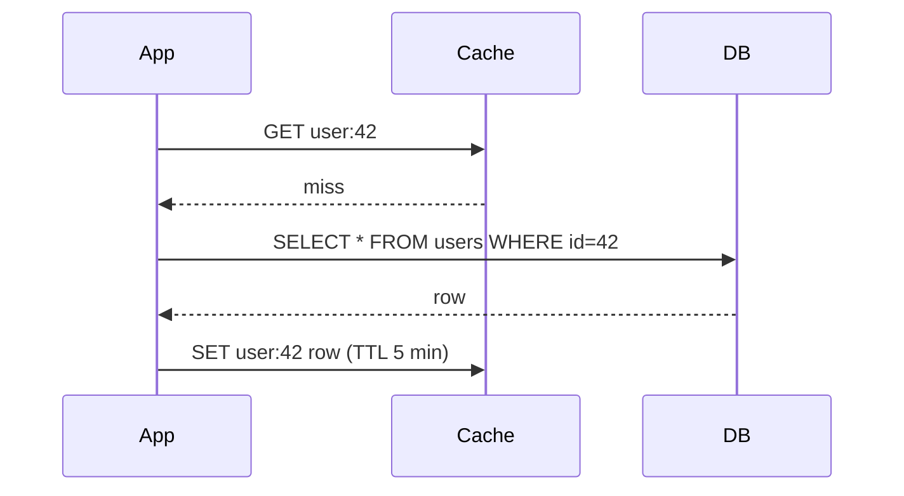

# 06 · Caching Fundamentals

A cache keeps a copy of data somewhere faster or closer than its source, so that
repeated reads skip the expensive path. Caches exist at every layer: CPU caches, the OS
page cache, the database buffer pool, in-process maps, shared caches such as Redis or
Memcached, CDNs, and the browser. The same trade-off appears at each: **speed in
exchange for possibly stale data and extra moving parts.**

## When caching helps

Caching pays off when three things are true:

1. **Reads repeat.** The same keys are requested many times. Most real workloads are
   skewed — a small fraction of items gets most of the traffic.
2. **The source is expensive.** A complex query, a remote call, a rendered page.
3. **Some staleness is tolerable**, or you can invalidate reliably (Level 2 covers
   invalidation in depth).

It does *not* help much for write-heavy workloads, for data read once, or when every
request needs a fresh, exact answer (an account balance at payment time).

## Hit ratio is everything

If a cache lookup costs 1 ms and a database lookup 20 ms, the average read latency is:

```text
avg = hit_ratio × 1 ms + (1 − hit_ratio) × (1 ms + 20 ms)
hit 50% -> 11.0 ms     hit 90% -> 3.0 ms     hit 99% -> 1.2 ms
```

The load that reaches the database is `(1 − hit_ratio) × total`. Going from 90% to 99%
cuts database load *tenfold*. That also exposes a danger: if the cache empties (restart,
deploy, eviction storm), the database suddenly receives 10× or 100× its normal load. A
database sized for a warm cache often cannot survive a cold one.

## Caching patterns

**Cache-aside (lazy loading)** — the most common pattern. The application checks the
cache; on a miss, reads the database and fills the cache.



- Only requested data is cached. A cache failure degrades to slower reads, not errors.
- First read of each key is slow; stale data possible until TTL expiry or invalidation.

**Read-through** — same idea, but the cache library/service itself loads from the source
on a miss. Application code only talks to the cache.

**Write-through** — writes go to the cache and the source synchronously. The cache stays
fresh, but every write pays both costs, and data that is never read still gets cached.

**Write-behind (write-back)** — writes go to the cache and are flushed to the source
asynchronously. Fast writes, but data can be lost if the cache dies before flushing, and
ordering becomes tricky. Use only when that loss is acceptable.

## Eviction policies

Caches are finite. When full, something must go.

| Policy | Evicts | Notes |
|---|---|---|
| LRU | Least recently used | Good general default; a single scan of cold keys can flush hot ones |
| LFU | Least frequently used | Keeps long-term popular items; slow to adapt when popularity shifts |
| FIFO | Oldest inserted | Simple, usually worse hit ratio |
| TTL | Expired items | Bounds staleness; often combined with LRU/LFU |
| Random | Random item | Surprisingly decent and cheap |

Production caches often use refinements (sampled LRU, segmented LRU, or admission
filters such as TinyLFU) that resist scans better than textbook LRU.

## Worked example: an LRU cache with TTL

```python
# lru_ttl.py — a small LRU cache with per-entry TTL, standard library only
import time
from collections import OrderedDict

class LRUCache:
    def __init__(self, capacity, ttl_seconds, clock=time.monotonic):
        self.capacity, self.ttl, self.clock = capacity, ttl_seconds, clock
        self.data = OrderedDict()            # key -> (value, expires_at)
        self.hits = self.misses = 0

    def get(self, key):
        item = self.data.get(key)
        if item is None or item[1] < self.clock():
            self.data.pop(key, None)         # drop expired entry if present
            self.misses += 1
            return None
        self.data.move_to_end(key)           # mark as most recently used
        self.hits += 1
        return item[0]

    def put(self, key, value):
        self.data[key] = (value, self.clock() + self.ttl)
        self.data.move_to_end(key)
        if len(self.data) > self.capacity:
            self.data.popitem(last=False)    # evict least recently used

def slow_db_read(key):
    return f"row-{key}"

def get_user(cache, key):
    value = cache.get(key)
    if value is None:                        # cache-aside
        value = slow_db_read(key)
        cache.put(key, value)
    return value

if __name__ == "__main__":
    import random
    rng = random.Random(1)
    cache = LRUCache(capacity=100, ttl_seconds=60)
    # Skewed workload: key k chosen with probability ~ 1/k (Zipf-like), 10,000 keys
    keys = list(range(1, 10_001))
    weights = [1 / k for k in keys]
    for key in rng.choices(keys, weights, k=50_000):
        get_user(cache, key)
    total = cache.hits + cache.misses
    print(f"hit ratio with 1% of keys cached: {cache.hits / total:.0%}")
```

Holding just 1% of the keys yields a hit ratio of around 40% in this skewed workload,
because the most popular keys receive a large share of requests. Try a uniform workload
(`rng.choice(keys)`) and the hit ratio collapses to about 1% — a cache is only as good
as the skew in your access pattern.

## How It Actually Works

**Why LRU is O(1).** An LRU cache combines a hash map (key → node) with a doubly linked
list ordered by recency. A hit finds the node through the map and unlinks/relinks it at
the head — constant time. Eviction removes the tail — constant time. Python's
`OrderedDict` is implemented with exactly this combination, which is why `move_to_end`
and `popitem(last=False)` are cheap.

**What a shared cache server does.** A server such as Memcached or Redis keeps a large
in-memory hash table and answers simple network commands (`GET key`, `SET key value EX
300`). Most of the cost of a cache hit is the network round trip within the datacenter,
not the lookup. That is why fetching 100 keys one by one is far slower than a single
multi-get, and why an in-process cache (no network at all) is faster still — at the
cost of each app server holding its own, independently stale copy.

**Expiry mechanics.** Caches usually expire lazily (check the TTL when a key is read)
plus a background process that samples keys and removes expired ones, so memory is not
held forever by keys nobody reads again.

## Common mistakes

- **Caching without a TTL or invalidation plan.** Stale data forever.
- **Cache stampede**: a popular key expires and thousands of requests miss at once and
  hammer the database. Mitigations: request coalescing (one loader per key), early
  probabilistic refresh, or serving stale while refreshing.
- **Caching errors or empty results** unintentionally — or failing to cache "not found",
  letting repeated lookups for missing keys bypass the cache (negative caching helps).
- **Treating the cache as the source of truth.** Caches are allowed to lose data.
- **Unbounded in-process caches** that slowly consume all memory.

## Exercise

1. Run `lru_ttl.py`. Then change capacity to 10, 1,000, and 5,000 and plot (or tabulate)
   hit ratio against capacity. Where are diminishing returns?
2. Add a `stampede` test: 100 threads request the same missing key at once. Count how
   many call `slow_db_read`. Then add a per-key lock so only one does.
3. Your database handles 5,000 reads/s safely. Traffic is 40,000 reads/s with a 95% hit
   ratio. What happens if the cache restarts empty? Propose two ways to survive it.
