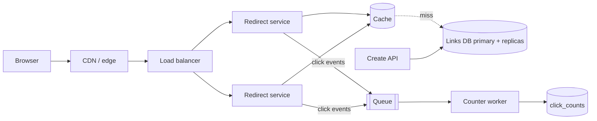

# 10 · Project — Design a URL Shortener

This project pulls together every Level 1 lesson. Try it yourself first: 45 minutes,
paper, and the five-step approach from lesson 1. Then read the walkthrough below and
compare decision by decision. Your design does not need to match — but you should be
able to defend every place it differs.

## Step 1 — Requirements

**Functional**

- Create a short link for a long URL; optionally choose a custom alias.
- Visiting the short link redirects to the long URL.
- Links may have an expiry time.
- The creator can see a click count per link.

**Out of scope**: user accounts beyond an API key, link editing, spam/malware scanning
(mentioned as a follow-up), detailed analytics dashboards.

**Non-functional**

- Redirects are the hot path: low latency (target p99 under ~50 ms server-side) and high
  availability — a broken shortener breaks every link ever shared.
- Short links should not be trivially enumerable.
- Once created, a mapping must never be lost or silently changed.
- Click counts can be slightly delayed (seconds to minutes) and approximate.

## Step 2 — Estimates

!!! note
    Assumptions are illustrative. The arithmetic is the skill being practised.

```text
New links:    100M per month  -> 100M / (30 × 10^5 s) ≈ 35/s avg, ~100/s peak
Redirects:    100:1 read ratio -> ≈ 3,500/s avg, ~10,000/s peak
Record size:  ~500 bytes (URL up to 2 KB, but average far lower) + metadata
Storage:      100M × 500 B = 50 GB/month ≈ 600 GB/year ≈ 3 TB over 5 years
```

Conclusions: writes are light; reads are heavy but tiny; data fits comfortably in one
database for years, but reads should mostly be served from cache. The redirect path's
**availability** is the most important property.

## Step 3 — API and data model

```text
POST /api/links
  headers: Authorization: Bearer <api key>, Idempotency-Key: <uuid>
  body:    {"url": "https://...", "alias": "optional", "expires_at": "optional"}
  201 ->   {"code": "aZ3kP9q", "short_url": "https://sho.rt/aZ3kP9q"}

GET /{code}          -> 301/302 Location: <long url>   | 404 | 410 if expired
GET /api/links/{code}/stats -> {"clicks": 1234}
```

```sql
CREATE TABLE links (
  code        VARCHAR(16) PRIMARY KEY,
  long_url    TEXT        NOT NULL,
  owner_key   VARCHAR(64) NOT NULL,
  created_at  TIMESTAMP   NOT NULL,
  expires_at  TIMESTAMP   NULL
);
CREATE TABLE click_counts (
  code   VARCHAR(16) PRIMARY KEY,
  clicks BIGINT NOT NULL DEFAULT 0
);
```

**301 or 302?** A 301 (permanent) lets browsers cache the redirect, so repeat visits
never reach us — cheaper, but we lose click counts and cannot change or expire the link
for those browsers. A 302/307 (temporary) sends every visit to us. Because we promised
click counts and expiry, choose **302**, and set a short `Cache-Control` if desired.

## Step 4 — Generating short codes

This is the most-discussed decision. Options:

| Approach | How | Pros | Cons |
|---|---|---|---|
| Hash the URL | Take first 7 chars of base62(SHA-256(url)) | Same URL → same code | Collisions must be handled; same URL from two users shares a code (maybe unwanted) |
| Counter + base62 | Global counter, encode in base62 | No collisions, short | Sequential → enumerable; a single counter is a bottleneck/SPOF |
| Random | 7 random base62 chars, insert with uniqueness check | Not enumerable, simple, no coordination | Collision retry needed (rare while space is sparse) |
| Pre-generated key pool | Background job creates unused random codes; servers claim batches | Fast issue, no collision on hot path | Extra component; must not hand the same batch out twice |

Capacity check for 7 base62 characters: 62⁷ ≈ 3.5 × 10¹². After 5 years we hold about
6 × 10⁹ links, filling roughly 0.2% of the space, so a random code collides with an
existing one about 1 time in 600 — a single retry handles it.

We choose **random codes with a uniqueness constraint**:

```python
# shortener.py — core logic with SQLite standing in for the real database
import secrets, sqlite3, string, time

ALPHABET = string.ascii_letters + string.digits   # 62 characters
db = sqlite3.connect(":memory:")
db.execute("""CREATE TABLE links(code TEXT PRIMARY KEY, long_url TEXT NOT NULL,
              created_at REAL NOT NULL, expires_at REAL)""")

def new_code(n=7):
    return "".join(secrets.choice(ALPHABET) for _ in range(n))

def create(long_url, alias=None, ttl=None, attempts=5):
    if not long_url.startswith(("http://", "https://")):
        raise ValueError("only http(s) URLs allowed")
    expires = time.time() + ttl if ttl else None
    for _ in range(1 if alias else attempts):
        code = alias or new_code()
        try:
            with db:                                   # transaction
                db.execute("INSERT INTO links VALUES (?,?,?,?)",
                           (code, long_url, time.time(), expires))
            return code
        except sqlite3.IntegrityError:                 # code already taken
            if alias:
                raise ValueError("alias taken")
    raise RuntimeError("could not allocate a code")

def resolve(code):
    row = db.execute("SELECT long_url, expires_at FROM links WHERE code=?",
                     (code,)).fetchone()
    if row is None:
        return 404, None
    if row[1] is not None and row[1] < time.time():
        return 410, None
    return 302, row[0]

c = create("https://example.com/some/very/long/path?x=1")
print(c, resolve(c))                    # e.g. 'aZ3kP9q' (302, 'https://example.com/...')
print(resolve("nope123"))               # (404, None)
print(create("https://example.org", alias="docs"), resolve("docs"))
```

`secrets` rather than `random` matters: codes should be unpredictable.

## Step 5 — High-level architecture



- **Redirect service**: stateless; looks up `code` in the cache, falls back to a read
  replica, returns 302. Mappings are immutable, so caching is nearly free of staleness
  problems — only expiry and deletion need care (cache with a TTL no longer than the
  link's remaining lifetime).
- **Cache sizing**: link popularity is highly skewed. Caching the hottest ~20% of recent
  links (a few tens of GB at most by our estimate) should serve the large majority of
  redirects.
- **Click counting**: incrementing a database row on every redirect would put 10,000
  writes/s on hot rows. Instead, the redirect service emits a click event to a queue and
  returns immediately. A worker aggregates events in memory and flushes
  `UPDATE click_counts SET clicks = clicks + ?` every few seconds. Counts lag slightly —
  which the requirements allow.
- **Create API**: writes to the primary. The `Idempotency-Key` header makes a retried
  create return the same code instead of making a second link.

## Step 6 — Deep dives and failure modes

- **Database primary down**: redirects keep working from cache and replicas; creates fail
  until failover. Acceptable given priorities.
- **Cache down**: all redirects hit replicas. At ~10,000/s of primary-key reads, several
  replicas can likely absorb it, so provision them for that case rather than for the
  warm-cache case alone.
- **Queue down**: redirects must *not* fail because counting failed. Drop or locally
  buffer click events; counts become approximate.
- **Abuse**: shorteners are used to disguise malicious links. Rate-limit creation per
  API key (Level 2, lesson 6) and scan URLs asynchronously; flagged codes return a
  warning page.
- **Hot link**: a link shared by a celebrity can take a large share of traffic. It is
  cached everywhere, and the CDN can cache the 302 for a few seconds to absorb spikes.

## How It Actually Works

**Why the redirect is cheap.** A redirect is one primary-key lookup and a response of a
few hundred bytes with a `Location` header. The browser does the rest: on a 302 it issues
a new request to the long URL, which is someone else's server. Our service never
proxies content, so bandwidth stays tiny even at high request rates.

**Why random IDs need no coordination.** Every server generates codes independently from
a cryptographic random source. The only coordination is the database's uniqueness check
on insert, which is local to one partition if we later shard by `code`. Contrast a
global counter, which requires every create to touch one shared value — a scaling limit
and a single point of failure unless you hand out counter ranges in blocks.

**Why counters go through a queue.** Updating the same row thousands of times per second
serializes on that row's lock. Aggregating in a worker converts thousands of `+1`
writes into one `+N` write per interval: the same total, with orders of magnitude fewer
database operations.

## Common mistakes

- Using a 301 and then promising click analytics.
- Sequential codes that let anyone enumerate every link ever created.
- Updating counters synchronously on the redirect path.
- Forgetting to validate URLs (e.g. `javascript:` schemes) before storing them.
- Sizing the database for the warm-cache case only.

## Exercise

1. Extend `shortener.py` with an in-process LRU cache from lesson 6 in front of `resolve`,
   and ensure expired links are never served from cache.
2. Add an idempotency-key table so repeated `create` calls with the same key return the
   same code.
3. Suppose requirements change: 10 billion new links per month. Redo the estimates.
   Which parts of the design break first, and what would you change? (You will have
   better tools for this after Level 2's sharding lessons — come back and revise.)
4. Write a one-page design doc for your version, including a "rejected alternatives"
   section explaining why you did not choose the other ID-generation schemes.
