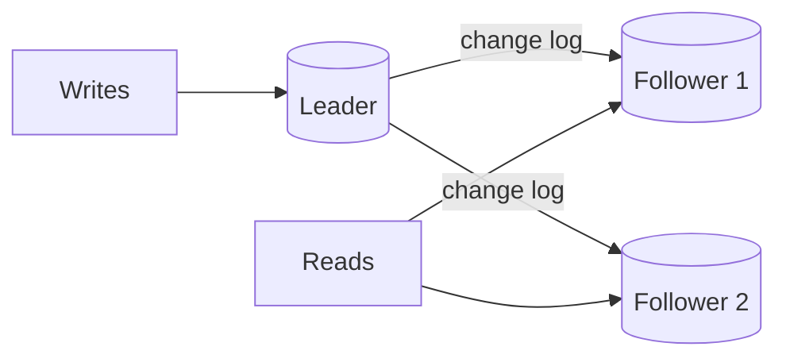

# 01 · Replication

Replication keeps copies of the same data on several machines. Teams replicate for three
different reasons, and it helps to know which one you are after:

- **Availability** — if one machine dies, another has the data.
- **Read scaling** — spread reads across copies.
- **Latency** — put a copy near users in another region.

Replication does *not* help write capacity: every copy must apply every write. (That is
what partitioning is for, in the next lesson.)

## Leader-follower (primary-replica)

One node, the **leader**, accepts all writes. It records each change in a log and ships
the log to **followers**, which apply the changes in the same order. Reads can go to the
leader or to followers.



This is the default for most relational databases and many others. It is simple to
reason about because there is exactly one order of writes.

### Synchronous vs asynchronous

- **Synchronous**: the leader waits for a follower to confirm before acknowledging the
  write to the client. The confirmed write survives the leader's death. But if that
  follower is slow or down, writes stall.
- **Asynchronous**: the leader acknowledges immediately and ships changes afterward.
  Fast and resilient to slow followers, but if the leader dies, recent acknowledged
  writes that had not been shipped are **lost**.
- **Semi-synchronous**: wait for *one* of several followers. A common compromise: at
  least two copies of each acknowledged write, without depending on any single follower.

## Replication lag and the anomalies it causes

With asynchronous followers, a follower may be milliseconds — or, under load, minutes —
behind. Reading from it produces anomalies that users notice:

1. **Read-your-writes violation.** A user updates their profile, the page reloads from a
   lagging follower, and the old value appears. They think the save failed.
2. **Monotonic reads violation.** Two consecutive reads hit different followers; the
   second is further behind, so data appears to go back in time.
3. **Consistent prefix violation.** A reader sees an answer before the question it
   replies to, because they were written to different partitions that lag differently.

Mitigations:

- Read a user's *own* recently modified data from the leader (for example for one
  minute after they write, tracked with a timestamp in their session).
- Pin each user to one follower (monotonic reads).
- Have clients remember the log position of their last write and only read from a
  follower that has reached it.

## Worked example: simulating lag

```python
# replication_lag.py — async leader/follower with a visible read-your-writes anomaly
import heapq

class Leader:
    def __init__(self):
        self.data, self.log = {}, []            # log: list of (position, key, value)
    def write(self, key, value):
        self.data[key] = value
        self.log.append((len(self.log) + 1, key, value))
        return len(self.log)                    # log position of this write

class Follower:
    def __init__(self, lag):
        self.data, self.applied, self.lag = {}, 0, lag
    def catch_up(self, leader, now, write_times):
        # apply every entry whose write time + lag has passed
        while self.applied < len(leader.log) and write_times[self.applied] + self.lag <= now:
            _, k, v = leader.log[self.applied]
            self.data[k] = v
            self.applied += 1

leader, follower = Leader(), Follower(lag=2.0)
write_times = []

def write(key, value, now):
    write_times.append(now)
    return leader.write(key, value)

pos = write("bio:ana", "Hello", now=0.0)
follower.catch_up(leader, 0.5, write_times)
print("t=0.5 follower:", follower.data.get("bio:ana"))       # None — lagging
print("t=0.5 leader:  ", leader.data.get("bio:ana"))         # Hello

def read_your_writes(key, min_pos, now):
    follower.catch_up(leader, now, write_times)
    if follower.applied >= min_pos:
        return follower.data.get(key), "follower"
    return leader.data.get(key), "leader"                    # fall back

print(read_your_writes("bio:ana", pos, now=0.5))             # ('Hello', 'leader')
print(read_your_writes("bio:ana", pos, now=2.5))             # ('Hello', 'follower')
```

The fix uses the log position returned by the write: a read is served by the follower
only if it has applied at least that position. Several real databases expose log
positions or similar tokens so that applications can do exactly this.

## Failover

When the leader dies, a follower must be promoted. Each step hides a hazard:

1. **Detecting failure** — usually a timeout. Too short and a slow leader is replaced
   needlessly; too long and writes are unavailable for longer.
2. **Choosing the new leader** — ideally the most up-to-date follower. With async
   replication, any writes it had not received are gone.
3. **Reconfiguring clients** to write to the new leader.
4. **Handling the old leader** if it comes back believing it is still leader. Two
   leaders accepting writes (**split brain**) can corrupt data. Systems prevent this with
   fencing: the new leader gets a higher epoch/term number, and storage or peers reject
   writes carrying an older one.

Level 3's consensus lesson explains how systems agree on a leader safely.

## Multi-leader replication

Several nodes accept writes (often one per region) and replicate to each other.
Advantages: local write latency in every region and tolerance of a region going offline.
The cost: **write conflicts** — two regions can modify the same record concurrently.
Resolution strategies include last-writer-wins (simple, silently discards data),
application-level merge logic, and conflict-free replicated data types (CRDTs) for data
types with well-defined merges (counters, sets). Multi-leader is powerful and easy to get
wrong; prefer designs where each record has a single "home" region when you can.

## Leaderless replication and quorums

In leaderless (Dynamo-style) systems the client, or a coordinator node, sends each write
to all N replicas and waits for **W** acknowledgements; reads query replicas and wait for
**R** responses, taking the newest version.

If **R + W > N**, every read set overlaps every write set in at least one replica, so a
read will usually see the latest acknowledged write. With N=3, W=2, R=2 you tolerate one
unavailable node for both reads and writes.

"Usually" is deliberate: concurrent writes, sloppy quorums (writing to substitute nodes
during failures), and clock-based conflict resolution can still produce stale or lost
updates. Quorums improve the odds; they are not the same as linearizability.

## How It Actually Works

A database already keeps a sequential log for crash recovery — the **write-ahead log
(WAL)**. Before changing data pages, it appends a record of the change to the log and
flushes it to disk; after a crash it replays the log. Physical replication simply streams
those log records to followers, which replay them exactly as crash recovery would. That
is why followers are byte-for-byte copies and why they must run compatible versions.

Logical replication instead ships higher-level changes ("row with id 7 in table users
set name='Ana'"). It is more flexible — different versions, subsets of tables, feeding
other systems (Level 3's CDC lesson builds on it) — at some cost in overhead.

Replication lag is just the distance between the leader's latest log position and the
follower's applied position. It grows whenever the follower applies changes more slowly
than the leader produces them: a heavy batch update, a long-running query on the follower
holding resources, or a network hiccup. Monitoring that distance is one of the most
important replication metrics you can alert on.

## Common mistakes

- **Reading from replicas without thinking about lag** — especially right after a write.
- **Believing async replication is lossless.** Acknowledged writes can vanish on failover.
- **Automatic failover without fencing**, leading to split brain.
- **Using replicas as backups.** A bad `DELETE` replicates instantly. Backups and
  point-in-time recovery are separate.
- **Multi-leader "for performance"** without a conflict-resolution plan.

## Exercise

1. Extend `replication_lag.py` with two followers of different lag and a load-balanced
   read function. Produce a monotonic-reads violation, then fix it by pinning a session to
   one follower.
2. With N=5, list every (R, W) pair that satisfies R + W > N. Which would you pick for a
   read-heavy workload, and how many node failures does each tolerate for writes?
3. Your leader is replicated asynchronously to two followers in the same region. Describe
   exactly what data could be lost if the leader's disk fails, and propose a change that
   bounds the loss.
