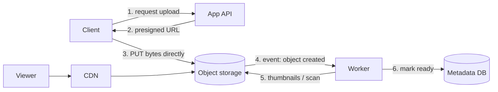

# 09 · Blob & Object Storage

Photos, videos, backups, logs, ML datasets, PDF invoices — large binary objects ("blobs")
make up most of the bytes in many systems. They do not belong in a relational database:
large values bloat backups and replication, fill the buffer cache with data nobody
queries, and make the database the bandwidth bottleneck. Instead, systems use **object
storage**: a flat namespace of buckets and keys, each key holding an immutable object
plus a little metadata, accessed over HTTP.

Examples include managed cloud services (Amazon S3, Google Cloud Storage, Azure Blob
Storage) and self-hosted systems with S3-compatible APIs (such as MinIO or Ceph's object
gateway). The API is simple: `PUT` an object, `GET` it (optionally a byte range),
`DELETE` it, `LIST` keys by prefix.

## The standard pattern: bytes in object storage, metadata in a database



1. The client asks the API to upload. The API authorizes it, creates a metadata row
   (`status = 'pending'`), and returns a **presigned URL** — a URL containing a signature
   that grants permission to `PUT` one specific key for a few minutes.
2. The client uploads directly to object storage. Bytes never pass through app servers,
   which would otherwise spend their bandwidth and memory proxying uploads.
3. Object storage emits an event (or the client confirms). A worker validates the file,
   scans it, generates derivatives (thumbnails, transcodes), and marks the metadata row
   `ready`.
4. Downloads are served through a CDN in front of the bucket, or via short-lived presigned
   GET URLs for private content.

## Worked example: presigned URLs, locally

Cloud SDKs generate presigned URLs for you. To understand what they are, here is a
simplified HMAC-based version you can run anywhere. (Real providers' signing schemes are
more involved, but the principle is the same.)

```python
# presign.py — the idea behind presigned URLs: an expiring, tamper-proof permission
import hashlib, hmac, time
from urllib.parse import urlencode, urlparse, parse_qs

SECRET = b"server-side-secret-never-sent-to-clients"

def presign(method, key, ttl=300, now=None):
    expires = int((now or time.time()) + ttl)
    msg = f"{method}\n{key}\n{expires}".encode()
    sig = hmac.new(SECRET, msg, hashlib.sha256).hexdigest()
    return f"https://storage.example/{key}?" + urlencode({"expires": expires, "sig": sig})

def verify(method, url, now=None):
    u = urlparse(url)
    q = {k: v[0] for k, v in parse_qs(u.query).items()}
    key, expires = u.path.lstrip("/"), int(q["expires"])
    if (now or time.time()) > expires:
        return False, "expired"
    expected = hmac.new(SECRET, f"{method}\n{key}\n{expires}".encode(),
                        hashlib.sha256).hexdigest()
    if not hmac.compare_digest(expected, q["sig"]):
        return False, "bad signature"
    return True, "ok"

url = presign("PUT", "uploads/user42/photo-9f1c.jpg", now=1_000_000)
print(verify("PUT", url, now=1_000_100))                         # (True, 'ok')
print(verify("PUT", url, now=1_000_400))                         # (False, 'expired')
print(verify("PUT", url.replace("user42", "user43"), now=1_000_100))  # bad signature
print(verify("GET", url, now=1_000_100))                         # bad signature: wrong method
```

The storage service holds the secret (or a key it can verify against) and checks the
signature, expiry, method, and key. The client can use the URL but cannot change what it
grants.

## Large files: multipart and resumable uploads

A 5 GB video over a mobile network will fail partway. Multipart uploads split the file
into parts (for example 8–100 MB each), upload them independently — in parallel, retrying
only failed parts — and then issue a "complete" call listing the parts. Downloads use
**range requests** (`Range: bytes=0-1048575`) for the same reasons, and video players rely
on them to seek.

Remember to clean up abandoned multipart uploads; incomplete parts can consume billable
storage until removed (many services support a lifecycle rule for this).

## Naming keys

- Do not use user-provided filenames as keys. Generate a unique key
  (`uploads/{user_id}/{uuid}.jpg`) and keep the original name as metadata.
- Keys are often effectively immutable: to "edit" an image, write a new key and update the
  metadata pointer. This plays well with CDN caching (Level 1, lesson 8).
- Some services partition internally by key prefix and scale request rate per prefix;
  check your provider's current guidance before designing extreme request rates on a
  single prefix.

## Durability, availability, and cost tiers

Object stores are designed for very high durability by storing data redundantly across
disks and, typically, across failure zones. Providers publish durability and availability
targets for each storage class; read them for your provider rather than assuming.
Storage classes trade price per GB against retrieval cost and latency:

| Tier | Use | Trade-off |
|---|---|---|
| Standard / hot | Frequently accessed content | Highest per-GB price, cheap access |
| Infrequent access | Backups, older media | Cheaper storage, per-GB retrieval fees, minimum storage durations |
| Archive / cold | Compliance archives | Very cheap storage, retrieval can take minutes to hours |

**Lifecycle rules** move objects between tiers by age (e.g. to infrequent access after 30
days, archive after a year, delete after seven) — often the easiest large cost saving in
a storage-heavy system.

## How It Actually Works

An object store has two planes. The **metadata plane** maps `bucket/key` to the object's
size, checksum, and the locations of its data chunks; it must be strongly consistent (a
distributed, replicated, partitioned key-value store). The **data plane** stores the
chunks themselves across many storage nodes.

For durability, chunks are either **replicated** (e.g. three full copies on different
nodes/zones — 3× storage overhead) or **erasure coded**. With erasure coding, an object is
split into *k* data fragments plus *m* parity fragments computed so that *any k of the
k + m* can reconstruct the original. A 10 + 4 scheme survives the loss of any four
fragments with only 1.4× storage overhead, compared with 3× for triple replication. The
cost is CPU for encoding and more work to read or repair, so systems often replicate hot
data and erasure-code colder data.

Background processes continuously **scrub** data — reading and verifying checksums to catch
silent corruption — and re-create lost fragments when a disk or node fails, so redundancy
is restored before further failures accumulate.

## Common mistakes

- **Storing blobs in the relational database.**
- **Proxying uploads and downloads through app servers** instead of presigned URLs and a CDN.
- **Public buckets by accident.** Default to private; grant access with signed URLs or a
  CDN origin identity.
- **Trusting uploaded content**: validate type and size server-side, scan for malware, and
  never serve user uploads from your main application domain.
- **Metadata and bytes out of sync**: rows pointing to objects that never finished
  uploading, or orphaned objects no row references. Use a `pending` state and periodic
  reconciliation.

## Exercise

1. Extend `presign.py` so a URL can also restrict the maximum upload size and content type,
   and show a tampered size limit is rejected.
2. Design the full upload flow for a document-signing app where files are confidential,
   must be virus-scanned before anyone can view them, and must be retained for 7 years.
   Include states, lifecycle rules, and access control.
3. Compare the storage cost of 1 PB with 3× replication vs a 10+4 erasure code, in raw
   capacity needed. How many simultaneous fragment losses does each tolerate?
