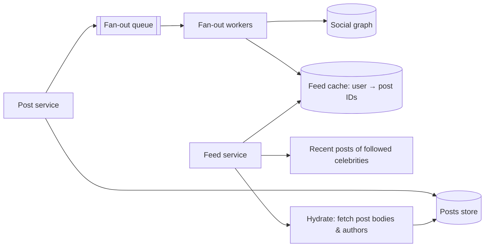

# 10 · Project — Design a News Feed

A home feed shows each user recent posts from the accounts they follow. It looks like a
simple query and is one of the classic scaling problems, because one write (a post) must
become visible in many readers' feeds, and followers are distributed extremely unevenly.
Attempt the design yourself before reading on.

## Requirements

**Functional**

- Users create posts (text plus optional media).
- Users follow other users (one-directional).
- The home feed lists posts from followed accounts, newest first (ranking is an
  extension), paginated.

**Non-functional** (assumptions for this exercise)

- 200M daily active users; each opens the feed ~10 times/day; each posts 0.5 times/day.
- Average user follows 200 accounts; follower counts are heavily skewed — most have
  hundreds, a few have tens of millions.
- Feed load p99 under ~300 ms. A new post may take a few seconds to appear in followers'
  feeds. Feeds must never show posts from someone you do not follow (privacy).

## Estimates

!!! note
    Rough, stated-assumption arithmetic; the conclusions matter more than the digits.

```text
Feed reads:  200M × 10 / 10^5 s ≈ 20,000/s avg, maybe ~60,000/s peak
Posts:       200M × 0.5 / 10^5 ≈ 1,000/s avg, ~3,000/s peak
Fan-out:     if each post is copied to every follower's feed, and the average post
             reaches ~200 followers: 1,000 × 200 ≈ 200,000 feed inserts/s on average
Feed store:  keep the latest ~500 post IDs per user × 8 bytes ≈ 4 KB/user
             × 200M users ≈ 800 GB (before replication) — fits in a distributed cache
```

## The central choice: fan-out on write vs fan-out on read

**Fan-out on read (pull).** Store posts per author. To build a feed, fetch the list of
followees, get recent posts from each, merge by time.

- Posting is cheap (one write).
- Reading is expensive: 200 followees → 200 lookups per feed load, merged — at 60,000
  loads/s. Hard to make fast.

**Fan-out on write (push).** When someone posts, insert the post ID into a precomputed
feed list for every follower. Reading a feed is one lookup.

- Reads are cheap and fast.
- Writes are amplified: a post by an account with 30 million followers means 30 million
  inserts — minutes of work, and a huge load spike.

**Hybrid (the usual answer).** Push for ordinary accounts; for accounts above a follower
threshold ("celebrities"), do not fan out. At read time, merge the precomputed feed with
recent posts pulled from the few celebrities the reader follows.



## Worked example: hybrid fan-out in miniature

```python
# feed.py — hybrid fan-out: push for normal users, pull for celebrities
import heapq, itertools
from collections import defaultdict, deque

CELEBRITY_THRESHOLD = 3          # tiny for the demo; think ~hundreds of thousands
FEED_LEN = 500
clock = itertools.count(1)       # monotonically increasing timestamps

followers = defaultdict(set)     # author -> followers
following = defaultdict(set)     # user -> authors
posts_by_author = defaultdict(list)          # author -> [(ts, post_id)]
feeds = defaultdict(lambda: deque(maxlen=FEED_LEN))   # user -> newest-first post refs

def follow(user, author):
    followers[author].add(user)
    following[user].add(author)

def is_celebrity(author):
    return len(followers[author]) >= CELEBRITY_THRESHOLD

def post(author, post_id):
    ts = next(clock)
    posts_by_author[author].append((ts, post_id))
    if not is_celebrity(author):              # fan-out on write (async in real life)
        for f in followers[author]:
            feeds[f].appendleft((ts, post_id))

def read_feed(user, limit=5):
    pushed = list(feeds[user])                              # already newest-first
    pulled = [sorted(posts_by_author[a], reverse=True)[:limit]
              for a in following[user] if is_celebrity(a)]
    merged = heapq.merge(pushed, *pulled, reverse=True)     # merge sorted streams
    return [pid for _, pid in itertools.islice(merged, limit)]

for u in ["ana", "ben", "cy", "dee"]:
    follow(u, "star")                 # star has 4 followers -> celebrity
follow("ana", "ben")
follow("ana", "cy")

post("ben", "ben-1")
post("star", "star-1")
post("cy", "cy-1")
post("star", "star-2")
print(read_feed("ana"))   # ['star-2', 'cy-1', 'star-1', 'ben-1']
print(len(feeds["ana"]), "pushed entries; star's posts were never copied")
```

Real systems add details the demo skips: fan-out happens asynchronously through a queue;
feeds store only IDs, and a separate **hydration** step fetches post bodies and author
profiles (from caches) in bulk; and the celebrity check uses a cached flag rather than
counting followers each time.

## Deep dives

**Feed storage.** A per-user list of the latest few hundred post IDs in a distributed
in-memory store, partitioned by `user_id`. It is a cache: if lost, it can be rebuilt
by pulling from followees (slow, but correct). Inactive users' feeds can be dropped and
rebuilt on their next visit — skipping fan-out to users who have not logged in for weeks
saves a large share of write work.

**Pagination.** Use a cursor encoding the last `(timestamp, post_id)` seen (Level 1,
lesson 9). Offsets break because new posts are constantly inserted at the top.

**Deletes and privacy.** If a post is deleted, or a user blocks someone, precomputed feeds
still contain the IDs. The hydration step must filter deleted or no-longer-visible posts
at read time; a background job can also purge them. Never rely on fan-out alone for access
control.

**Unfollow.** Remove future fan-out immediately; filter at read time until old entries age
out, or run a cleanup job.

**Ranking.** A ranked feed pulls a larger candidate set (e.g. several hundred recent IDs),
scores each with a model using features such as affinity with the author and engagement,
and returns the top results. Ranking adds a scoring service to the read path and is
typically tuned with experiments; the fan-out architecture underneath is the same.

**Media.** Post images and video live in object storage behind a CDN (lessons 9 and
Level 1 lesson 8); the feed carries only references.

## Failure modes

- **Fan-out backlog**: a burst of posts makes the queue grow; feeds become stale but reads
  keep working. Monitor lag; scale workers.
- **Feed cache node lost**: affected users get rebuilt-on-read feeds (slower) until warm.
- **Hot celebrity post**: millions of readers pull the same few posts — cache those posts
  aggressively; they are ideal cache entries.

## How It Actually Works

The hybrid design works because of the shape of the follower distribution. Most accounts
have modest follower counts, so pushing their posts costs a bounded number of writes. A
tiny number of accounts have enormous counts; pushing their posts would dominate total
write volume. By pulling only those few at read time, each feed load adds a handful of
extra lookups (a user follows only a few celebrities), while write amplification drops
dramatically. The threshold is a tunable knob that trades write cost against read cost.

The read-time merge is a k-way merge of already-sorted lists — the pushed feed and each
celebrity's recent posts — using a heap. It costs O(n log k) for n returned items and k
streams, which is cheap because both n and k are small.

## Common mistakes

- **Pure fan-out on write**, ignoring celebrities.
- **Pure fan-out on read** at high feed QPS, with no precomputation.
- **Storing full post content in each follower's feed**, multiplying storage and making
  edits and deletes painful.
- **Offset pagination** on a constantly changing list.
- **Treating the feed cache as the source of truth**, with no rebuild path.

## Exercise

1. Add `unfollow` and `delete_post` to `feed.py`, making sure `read_feed` never returns a
   deleted post or a post from an unfollowed author.
2. Add cursor pagination to `read_feed`.
3. Re-estimate the fan-out write rate if 0.01% of users have 1M followers each and are
   pushed normally. What threshold would you choose, and how would you evaluate it?
4. Write a one-page design doc with your final architecture, key numbers, and three
   failure scenarios with their user-visible impact.
