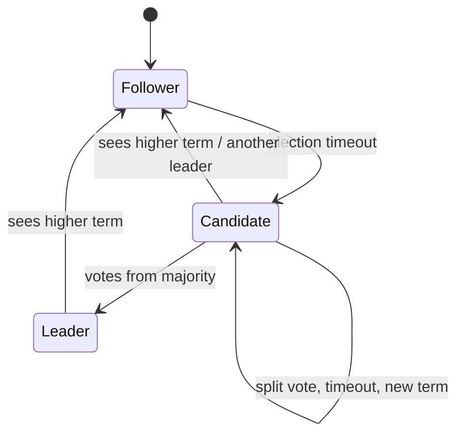

# 01 · Consensus Basics: Raft Conceptually

Many parts of a distributed system need a single, agreed answer: who is the current
database leader, which node owns partition 17, whether a lock is held, what the cluster
configuration is. **Consensus** protocols let a group of machines agree on a sequence of
values even when some of them crash or messages are delayed. You rarely implement one
yourself — you use a system built on one (etcd, ZooKeeper, Consul, or a database with
built-in consensus) — but you must understand what it guarantees and what it costs.

Raft was designed explicitly to be understandable, so it is the best way in.

## The replicated state machine idea

If several servers start in the same state and apply the same commands in the same
order, they end in the same state. So "agree on state" reduces to "agree on an ordered
log of commands". Raft's job is to keep that log identical on a majority of servers, even
through failures.

## Roles and terms

Each server is a **follower**, a **candidate**, or the **leader**. Time is divided into
**terms**, numbered 1, 2, 3, … Each term has at most one leader.

- Followers passively accept entries from the leader.
- If a follower hears nothing from a leader for an **election timeout**, it becomes a
  candidate, increments the term, votes for itself, and asks others for votes.
- A candidate that receives votes from a **majority** becomes leader for that term.
- Every message carries the sender's term. A server that sees a higher term immediately
  steps down to follower and adopts it. This is how stale leaders are deposed.

## Leader election



Two safety rules make elections correct:

1. **One vote per term.** A server votes for at most one candidate per term (and records
   the vote durably). Since two majorities of the same cluster always overlap, two leaders
   cannot win the same term.
2. **Up-to-date check.** A server refuses to vote for a candidate whose log is less
   up to date than its own. This guarantees the winner has every committed entry.

**Randomized timeouts** (e.g. 150–300 ms, chosen randomly per server) make split votes
rare: usually one server times out first and wins before others start.

## Log replication and commit

The leader appends client commands to its log and sends them to followers
(`AppendEntries`). An entry is **committed** once it is stored on a majority. Only then
does the leader apply it and reply to the client. Committed entries are never lost,
because any future leader must have them (rule 2 above).

Each `AppendEntries` includes the index and term of the entry just before the new ones.
A follower whose log does not match rejects the message; the leader backs up and resends
until the logs agree, overwriting the follower's conflicting, uncommitted entries. This
consistency check is what keeps every log a prefix of the leader's log.

## Worked example: a toy election simulator

This simulation models only elections (not log replication) to show how randomized
timeouts and majorities behave, including a partition.

```python
# raft_election.py — toy model of Raft leader election with randomized timeouts
import random

class Node:
    def __init__(self, nid, rng):
        self.id, self.rng = nid, rng
        self.term, self.voted_for, self.role = 0, None, "follower"
        self.reset_timer(0)
    def reset_timer(self, now):
        self.deadline = now + self.rng.uniform(150, 300)     # ms

def run(n=5, partitioned=frozenset(), ms=2000, seed=1):
    rng = random.Random(seed)
    nodes = [Node(i, rng) for i in range(n)]
    reachable = lambda a, b: (a in partitioned) == (b in partitioned)
    leaders = []
    for now in range(ms):
        for node in nodes:
            if node.role == "leader":                        # heartbeat every 50 ms
                if now % 50 == 0:
                    for peer in nodes:
                        if peer is not node and reachable(node.id, peer.id) \
                                and peer.term <= node.term:
                            peer.term, peer.role = node.term, "follower"
                            peer.reset_timer(now)
                continue
            if now >= node.deadline:                         # start an election
                node.term += 1
                node.role, node.voted_for = "candidate", node.id
                votes = 1
                for peer in nodes:
                    if peer is node or not reachable(node.id, peer.id):
                        continue
                    if peer.term < node.term:                # newer term: reset vote
                        peer.term, peer.voted_for, peer.role = node.term, None, "follower"
                    if peer.voted_for is None:
                        peer.voted_for = node.id
                        peer.reset_timer(now)
                        votes += 1
                if votes > n // 2:
                    node.role = "leader"
                    leaders.append((now, node.term, node.id))
                node.reset_timer(now)
    return leaders

print("healthy 5-node cluster:", run()[:3])
print("minority side {0,1}:   ",
      [l for l in run(partitioned=frozenset({0, 1})) if l[2] in (0, 1)])
print("majority side {2,3,4}: ",
      [l for l in run(partitioned=frozenset({0, 1})) if l[2] in (2, 3, 4)][:1])
```

The healthy cluster elects one leader shortly after the first timeout and keeps it,
because heartbeats reset everyone's timers. When nodes 0 and 1 are cut off, they keep
starting elections with ever-higher terms but can never gather 3 of 5 votes, so they
never elect a leader; the majority side elects one and continues. (A real minority node
with a higher term would disrupt the majority once the partition heals; production Raft
implementations add a "pre-vote" step to avoid that.)

## What consensus costs

- **Latency**: every committed write needs a round trip from the leader to a majority.
  In one datacenter that is sub-millisecond to a few milliseconds; across regions it is
  the inter-region round trip.
- **Throughput**: all writes go through one leader. Consensus groups are for
  coordination data and moderate write rates, not for bulk data — unless, as in many
  distributed databases, data is split into many independent consensus groups (one per
  partition).
- **Availability**: a cluster of 2f + 1 nodes tolerates f failures. Three nodes tolerate
  one; five tolerate two. Four nodes also tolerate only one (a majority of 4 is 3), which
  is why clusters use odd sizes.

## How It Actually Works

Everything rests on **majority intersection**. Any two majorities of the same N nodes
share at least one node. An entry is committed only after a majority stores it; a leader
is elected only by a majority. Therefore every electorate contains at least one node that
holds every committed entry — and because voters reject candidates with less up-to-date
logs, no candidate missing a committed entry can win. Committed entries survive every
leader change.

Terms act as a **logical clock** and a fencing mechanism. An old leader that was paused
(say, by a long garbage-collection pause) and wakes up still thinking it is leader will
send messages with an old term; recipients reject them and reply with the newer term,
and it steps down. It cannot commit anything, because it can no longer reach a majority
that accepts its term. That is how Raft avoids split brain without trusting clocks.

What consensus does *not* guarantee is progress under all conditions: with no majority
reachable, the system stops accepting writes. That is the CP choice from Level 2, lesson 4,
made explicit.

## Common mistakes

- **Even-sized clusters**, which add cost without adding fault tolerance.
- **Spreading a consensus group across distant regions** without accounting for the
  per-write round-trip cost.
- **Storing large or high-volume data** in a coordination service meant for small
  metadata.
- **Using leases or locks from a consensus store without fencing tokens** — a paused lock
  holder can still write to a downstream system after its lease expires. Pass the lease's
  monotonically increasing token to the downstream and reject stale tokens.
- **Rolling your own consensus.** Use a proven implementation.

## Exercise

1. Run `raft_election.py` with seeds 1–10 and record the time to first leader. Then narrow
   the timeout range to 150–155 ms and observe split votes becoming more frequent.
2. Partition a 5-node cluster 2/3 and then 1/4. Which sides elect leaders?
3. Explain in your own words why a 4-node cluster tolerates only one failure.
4. Design leader election for a cron-like scheduler that must run each job on exactly one
   of three servers. What happens if the leader is paused for 30 seconds mid-job, and how
   do fencing tokens prevent double effects?
