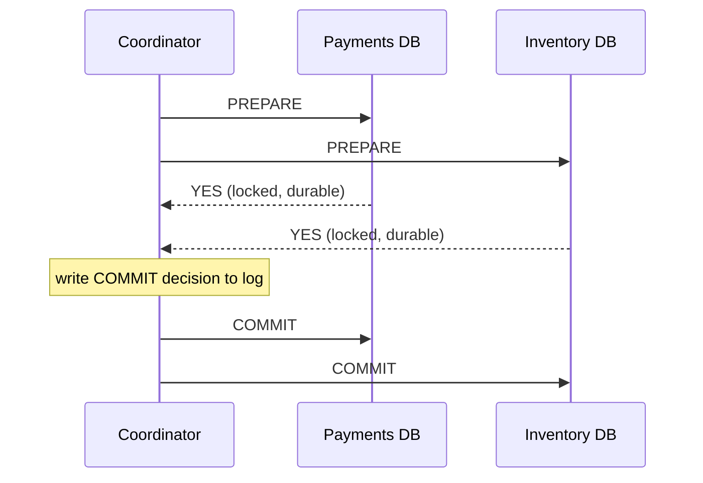

# 02 · Distributed Transactions & Sagas

Inside one database, "debit account A and credit account B" is a transaction: both
happen or neither does. Once A and B live in different services with different
databases — orders, payments, inventory, shipping — no single database can enforce that.
You have two broad options: a distributed commit protocol that tries to preserve atomic
behavior, or a **saga** that accepts intermediate states and repairs failures with
compensating actions.

## Two-phase commit (2PC)

A **coordinator** runs the transaction across **participants**:

1. **Prepare phase.** The coordinator asks every participant, "can you commit?" Each
   participant does the work, makes it durable (but not visible), locks what it needs,
   and votes yes or no.
2. **Commit phase.** If *all* voted yes, the coordinator records the decision durably and
   tells everyone to commit. If any voted no (or timed out), it tells everyone to abort.



**The blocking problem.** After voting yes, a participant has promised to commit if told
to and may not unilaterally abort. If the coordinator crashes after collecting votes but
before announcing the decision, participants sit **in doubt**, holding locks, until the
coordinator recovers. Everything touching those locked rows waits. Protocols such as
three-phase commit or running the coordinator on a consensus group reduce this risk, at
the price of more round trips and complexity.

2PC also requires every participant to support the protocol (XA-style interfaces in
many databases), holds locks across network round trips, and ties the availability of
the whole transaction to the least available participant. It is used inside distributed
databases (often built atop consensus groups) and in some enterprise middleware, but it
is uncommon between independently owned microservices.

## Sagas

A saga splits a business transaction into a sequence of **local transactions**, each in
one service. If step *k* fails, the saga runs **compensating transactions** for steps
*k−1 … 1* to semantically undo them.

```text
Place order saga
  T1 create order (PENDING)        C1 mark order CANCELLED
  T2 reserve inventory             C2 release reservation
  T3 authorize payment             C3 void authorization
  T4 confirm order (CONFIRMED)     —
```

Compensation is *semantic*, not a rollback: you cannot un-send an email, but you can send
a correction; you cannot un-charge a card, but you can refund it. Some steps are
**pivot** steps — after them, the saga must go forward (retrying until success) rather
than backward.

### Orchestration vs choreography

- **Orchestration**: a central saga orchestrator tells each service what to do next and
  tracks state. Easy to understand, monitor, and change; the orchestrator is an extra
  component (make it durable).
- **Choreography**: services react to each other's events ("inventory reserved" →
  payments authorizes). No central component, but the flow is implicit and spread across
  services, which becomes hard to follow beyond a few steps.

## Worked example: a durable-ish orchestrator

```python
# saga.py — orchestrated saga with compensations and a persisted step log
class StepFailed(Exception):
    pass

inventory = {"sku-1": 3}
payments, orders, log = {}, {}, []           # log = the orchestrator's durable state

def create_order(ctx):     orders[ctx["id"]] = "PENDING"
def cancel_order(ctx):     orders[ctx["id"]] = "CANCELLED"
def reserve(ctx):
    if inventory[ctx["sku"]] < ctx["qty"]:
        raise StepFailed("out of stock")
    inventory[ctx["sku"]] -= ctx["qty"]
def release(ctx):          inventory[ctx["sku"]] += ctx["qty"]
def authorize(ctx):
    if ctx["card"] == "declined":
        raise StepFailed("card declined")
    payments[ctx["id"]] = "AUTHORIZED"
def void(ctx):             payments[ctx["id"]] = "VOIDED"
def confirm(ctx):          orders[ctx["id"]] = "CONFIRMED"

STEPS = [(create_order, cancel_order), (reserve, release),
         (authorize, void), (confirm, None)]

def run_saga(ctx):
    done = []
    for action, compensate in STEPS:
        try:
            action(ctx)
            log.append((ctx["id"], action.__name__, "done"))
            done.append(compensate)
        except StepFailed as e:
            log.append((ctx["id"], action.__name__, f"failed: {e}"))
            for comp in reversed(done):            # compensate in reverse order
                if comp:
                    comp(ctx)
                    log.append((ctx["id"], comp.__name__, "compensated"))
            return "ROLLED BACK"
    return "COMMITTED"

print(run_saga({"id": "o1", "sku": "sku-1", "qty": 2, "card": "ok"}))
print(run_saga({"id": "o2", "sku": "sku-1", "qty": 1, "card": "declined"}))
print(orders, payments, inventory)
# {'o1': 'CONFIRMED', 'o2': 'CANCELLED'} {'o1': 'AUTHORIZED'} {'sku-1': 1}
for entry in log:
    print(entry)
```

In production the log lives in a database so that a crashed orchestrator can resume: on
restart, it reads incomplete sagas and continues forward or compensates from the last
recorded step. That means **every action and compensation must be idempotent** (lesson 3)
— after a crash, the orchestrator cannot know whether the last step ran, so it runs it
again. Workflow engines (Temporal-style durable execution, cloud step-function services)
package this pattern.

## The isolation gap

Sagas give up the "I" in ACID. Between T2 and C2, other transactions can see reserved
stock that will be released, or an order in `PENDING`. Countermeasures:

- **Semantic locks**: states like `PENDING` that other operations respect ("cannot ship a
  pending order").
- **Commutative updates**: design operations so order does not matter (increments rather
  than overwrites).
- **Reordering steps**: put the steps most likely to fail first, and irreversible steps
  (sending email, shipping) last, after the pivot.
- **Re-reading values** before acting, and version checks.

## How It Actually Works

The fundamental reason distributed atomic commit is hard is the same "no response"
ambiguity from Level 1, lesson 1: a participant that has voted yes cannot distinguish a
slow coordinator from a dead one, and it cannot safely decide on its own, because the
coordinator might have told others to commit (or to abort). Any protocol that guarantees
all-or-nothing across machines must, in some failure scenarios, wait. 2PC chooses
consistency and waits; it is a CP design at the level of a single transaction.

Sagas choose availability and progress instead. Each local transaction commits
immediately and releases its locks, so no service ever waits on another's failure. The
price is that the system passes through intermediate states visible to others, and
"undo" must be designed as business logic. The durable saga log plays the coordinator's
role, but because every step is already committed and every compensation is idempotent,
a crashed orchestrator delays the saga rather than blocking other transactions.

## Common mistakes

- **Using 2PC across services owned by different teams**, coupling their availability
  and holding locks across the network.
- **Non-idempotent compensations** that refund twice after an orchestrator restart.
- **Forgetting that compensation can fail** — it needs retries and, ultimately, human
  escalation.
- **Irreversible steps early in the saga** (charging a card before checking stock).
- **Ignoring the isolation gap**, then being surprised by anomalies under concurrency.

## Exercise

1. Add a `ship` step after `confirm` in `saga.py`. Should it have a compensation, or is
   `confirm` the pivot? Justify.
2. Simulate an orchestrator crash after `authorize` succeeds but before the log records it.
   Show how a restart with a non-idempotent `authorize` double-charges, then fix it with
   an idempotency key.
3. Design a travel-booking saga (flight, hotel, car) where the hotel cannot be cancelled
   for free after 24 hours. Order the steps and explain your compensation strategy.
