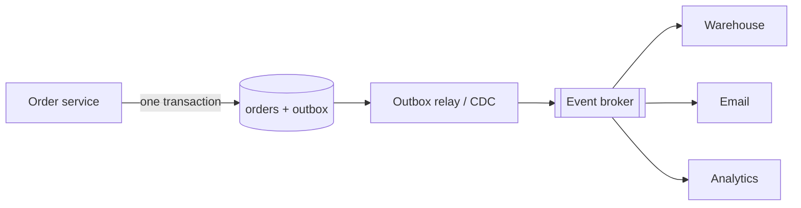

# 04 · Event-Driven Architecture & CDC

In an event-driven architecture, services announce facts — "OrderPlaced", "PaymentFailed",
"UserEmailChanged" — and other services react. The publisher does not know or care who
listens. Add a loyalty-points service next year and it simply subscribes; the order
service does not change.

This decoupling is powerful and comes with one notorious trap: getting an event out
reliably when the state change that caused it happens in a database.

## Events, commands, and queries

- A **command** asks someone to do something: `ReserveInventory(order 81, sku 3, qty 2)`.
  It has one intended handler and may be rejected.
- An **event** states that something happened: `OrderPlaced(order 81, …)`. It is in the
  past tense, cannot be rejected, and may have zero or many consumers.
- A **query** asks for data and changes nothing.

Mixing these up causes design confusion: an "event" that some consumer *must* act on for
correctness is really a command with hidden coupling.

**Event notification vs event-carried state.** A thin event (`OrderPlaced{id: 81}`) forces
consumers to call back for details, re-coupling them to the publisher. A fat event carries
the relevant state (`items`, `total`, `customer_id`), so consumers can act and build their
own local views without calls — at the cost of a larger, harder-to-evolve schema.

## The dual-write problem

The obvious implementation is broken:

```python
def place_order(order):
    db.insert(order)                 # 1. commit to database
    broker.publish("OrderPlaced", order)   # 2. publish event
```

If the process crashes between 1 and 2, the order exists but no event is ever published —
the warehouse never ships it. Swap the order and a crash leaves an event for an order that
does not exist. Wrapping both in a try/except does not help; there is no transaction that
spans a database and a broker.

## The transactional outbox

Write the event to an **outbox table in the same database transaction** as the state
change. A separate relay process reads the outbox and publishes to the broker, marking
rows as sent.



Because both rows commit atomically, an event exists if and only if the order does. The
relay may publish an event more than once (it can crash after publishing but before marking
it sent), so consumers must be idempotent — which lesson 3 already made a rule.

## Worked example: outbox with a relay

```python
# outbox.py — transactional outbox + relay, with an at-least-once publish
import json, sqlite3

db = sqlite3.connect(":memory:", isolation_level=None)
db.executescript("""
CREATE TABLE orders(id INTEGER PRIMARY KEY, customer TEXT, total INT);
CREATE TABLE outbox(seq INTEGER PRIMARY KEY AUTOINCREMENT, topic TEXT,
                    payload TEXT, published INT DEFAULT 0);
""")
broker = []                                   # stands in for Kafka/RabbitMQ/etc.

def place_order(customer, total, fail_before_commit=False):
    db.execute("BEGIN")
    cur = db.execute("INSERT INTO orders(customer,total) VALUES (?,?)", (customer, total))
    event = {"type": "OrderPlaced", "order_id": cur.lastrowid, "total": total}
    db.execute("INSERT INTO outbox(topic,payload) VALUES (?,?)",
               ("orders", json.dumps(event)))
    if fail_before_commit:
        db.execute("ROLLBACK")                 # crash: neither row survives
        return None
    db.execute("COMMIT")
    return cur.lastrowid

def relay_once(crash_after_publish=False):
    rows = db.execute("SELECT seq, topic, payload FROM outbox "
                      "WHERE published=0 ORDER BY seq").fetchall()
    for seq, topic, payload in rows:
        broker.append((topic, json.loads(payload)))
        if crash_after_publish:
            return                             # published but not marked
        db.execute("UPDATE outbox SET published=1 WHERE seq=?", (seq,))

place_order("ana", 4200)
place_order("ben", 999, fail_before_commit=True)   # no order, no event
relay_once(crash_after_publish=True)               # publishes, then "crashes"
relay_once()                                       # restart: publishes again
print(db.execute("SELECT COUNT(*) FROM orders").fetchone()[0], "order(s) in DB")
print([e["order_id"] for _, e in broker], "<- duplicate delivery; consumers dedupe on order_id")
```

## Change data capture (CDC)

Instead of polling an outbox table, **change data capture** reads the database's own
replication log (Level 2, lesson 1) and turns every committed row change into an event.
Tools such as Debezium do this for several popular databases, and many managed databases
offer native change streams.

Uses:

- **Relaying outbox rows** without polling (read inserts to the outbox table from the log).
- **Keeping derived systems in sync** — search indexes, caches (Level 2, lesson 8), data
  warehouses — without every code path remembering to update them.
- **Migrating data** between systems while the source stays live.

CDC of *internal tables* exposes your schema as an implicit public API: rename a column
and downstream consumers break. Prefer publishing deliberate outbox events for
cross-team contracts and raw CDC for systems you own end to end.

## Event schemas and evolution

Events live longer than code. Rules that keep consumers working:

- Version or register schemas (a schema registry with compatibility checks, or strict
  review of a shared definition).
- Only add optional fields; never change a field's meaning or type in place.
- Include an event ID (for dedup), an event time, and the entity's key (for partitioning
  and ordering).
- Partition by entity key so all events for one order stay in order (Level 2, lesson 5).

## Event sourcing, briefly

Event sourcing goes further: the event log *is* the source of truth, and current state is
derived by replaying events. It gives a complete audit history and makes new read models
easy to build. It also makes schema evolution, "delete this user's data" requests, and
simple queries notably harder. It suits domains with strong audit needs (ledgers) better
than general CRUD applications; treat it as a specialized tool, not a default.

## How It Actually Works

The outbox works because it reduces two writes to different systems into one write to a
single system that already supports atomic transactions. The relay then converts
"eventually publish every committed outbox row" into a simple, restartable loop: read
unpublished rows in order, publish, mark. Any crash leaves the loop in a state from which
rerunning it is safe, as long as consumers deduplicate.

CDC works because databases already produce an ordered, durable log of committed changes
for crash recovery and replication. A CDC connector registers as a replication client,
receives each committed change in commit order, and records its position in the log. On
restart it resumes from the stored position. Because the log contains only committed
transactions, CDC never emits events for rolled-back work — the property the naive dual
write lacked. One operational caveat: a stalled CDC consumer can force the database to
retain log segments it would otherwise discard, so CDC lag must be monitored like
replication lag.

## Common mistakes

- **Dual writes** to database and broker without an outbox or CDC.
- **Non-idempotent consumers**, given that relays and brokers deliver at least once.
- **Thin events that force callbacks**, re-creating synchronous coupling under an
  "event-driven" label.
- **Using events for things that need an immediate answer.**
- **Exposing raw CDC of internal tables** as a cross-team contract.
- **No way to replay**: keep events long enough, or keep the ability to re-snapshot.

## Exercise

1. Run `outbox.py`. Write an idempotent consumer that processes the broker list and
   ensures each `order_id` is handled once.
2. Add an `OrderCancelled` event. What must be true about ordering between `OrderPlaced`
   and `OrderCancelled` for the same order, and how do you guarantee it?
3. A search index must reflect product edits within a few seconds. Compare (a) dual writes
   from the product service, (b) an outbox, and (c) CDC on the products table. Pick one
   and describe how you would rebuild the index from scratch.
