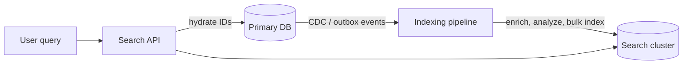

# 05 · Search Systems

"Find products matching *wireless noise cancelling headphones*" cannot be answered well by
`WHERE name LIKE '%headphones%'`. That query cannot use a normal index, does not rank
results, misses "headphone", and ignores the other words. Search systems solve a different
problem from databases: finding the *most relevant* documents for a free-text query, fast,
across millions of documents.

## The inverted index

A database index maps a row to its values. An **inverted index** maps each *term* to the
list of documents containing it (a **posting list**), often with positions and counts.

```text
doc 1: "wireless headphones with noise cancelling"
doc 2: "wired headphones"
doc 3: "wireless charging pad"

term        -> postings
wireless    -> [1, 3]
headphones  -> [1, 2]
noise       -> [1]
cancelling  -> [1]
wired       -> [2]
charging    -> [3]
pad         -> [3]
```

A query for `wireless headphones` intersects (AND) or unions (OR) the posting lists and
then ranks the candidates. Because posting lists are sorted by document ID, intersection
is a linear merge, and skip structures make it faster still.

## Analysis: turning text into terms

The same **analyzer** must process documents at index time and queries at search time:

1. **Tokenize**: split into words.
2. **Normalize**: lowercase, strip accents.
3. **Remove stop words** (optionally): "the", "with".
4. **Stem or lemmatize**: "cancelling" and "cancelled" → "cancel"; "headphones" →
   "headphone".
5. **Synonyms** (optionally): "earbuds" ↔ "earphones".

Analysis choices are the largest influence on search quality, and they are
language-specific.

## Relevance ranking

Classic scoring rewards terms that are frequent in the document but rare across the
collection:

- **TF (term frequency)**: a document mentioning "noise" three times is probably more
  about noise than one mentioning it once — with diminishing returns.
- **IDF (inverse document frequency)**: matching "cancelling" (rare) is more informative
  than matching "with" (everywhere).
- **Length normalization**: a match in a short title means more than one in a long page.

**BM25** combines these and is the default text-relevance function in widely used engines
such as Lucene-based systems. Production ranking then layers on business signals
(popularity, recency, personalization, availability) and increasingly on learned models
and vector similarity.

## Worked example: a tiny search engine with BM25

```python
# mini_search.py — inverted index + BM25 ranking (standard library only)
import math, re
from collections import Counter, defaultdict

STOP = {"with", "the", "a", "and", "for"}

def analyze(text):
    words = re.findall(r"[a-z0-9]+", text.lower())
    out = []
    for w in words:
        if w in STOP:
            continue
        for suffix in ("ing", "es", "s"):          # crude stemmer, demo only
            if w.endswith(suffix) and len(w) > len(suffix) + 2:
                w = w[: -len(suffix)]
                break
        out.append(w)
    return out

class Index:
    def __init__(self, k1=1.2, b=0.75):
        self.k1, self.b = k1, b
        self.postings = defaultdict(dict)          # term -> {doc_id: tf}
        self.lengths, self.docs = {}, {}

    def add(self, doc_id, text):
        terms = analyze(text)
        self.docs[doc_id], self.lengths[doc_id] = text, len(terms)
        for term, tf in Counter(terms).items():
            self.postings[term][doc_id] = tf

    def search(self, query, k=3):
        n = len(self.docs)
        avg_len = sum(self.lengths.values()) / n
        scores = defaultdict(float)
        for term in analyze(query):
            docs = self.postings.get(term, {})
            idf = math.log(1 + (n - len(docs) + 0.5) / (len(docs) + 0.5))
            for d, tf in docs.items():
                norm = tf + self.k1 * (1 - self.b + self.b * self.lengths[d] / avg_len)
                scores[d] += idf * tf * (self.k1 + 1) / norm
        return sorted(scores.items(), key=lambda x: -x[1])[:k]

idx = Index()
idx.add(1, "Wireless headphones with active noise cancelling")
idx.add(2, "Wired headphones for studio monitoring")
idx.add(3, "Wireless charging pad for phones")
idx.add(4, "Noise cancelling wireless earbuds with charging case")

for doc, score in idx.search("wireless noise cancelling headphones"):
    print(f"{score:.2f}  {idx.docs[doc]}")
```

Doc 1 ranks first (it matches all four terms), doc 4 second (three terms), and doc 2 third
(only "headphones"); doc 3 matches just "wireless" and falls outside the top three. Notice that the crude stemmer maps "phones" to "phon" and "headphones" to
"headphon" — different terms — which is exactly the kind of analysis subtlety real
analyzers handle with dictionaries and language rules.

## Architecture: search as a derived system

The search index is almost never the source of truth. It is a **derived view** of data in
a primary database, kept in sync by an indexing pipeline:



- **Freshness**: CDC-driven indexing typically lags by seconds. Say so in requirements;
  searching for something you created a moment ago may miss it.
- **Rebuilds**: keep the ability to reindex everything from the source (new analyzers,
  mapping changes, corruption). Build a new index alongside the old and switch an alias
  atomically.
- **Hydration**: return IDs and a few display fields from search; fetch authoritative data
  (price, stock) from the primary store for the final page.

## Scaling search

Search engines partition an index into **shards** (by document) and replicate each shard.

- A query is sent to one replica of every shard (scatter), each returns its local top-k,
  and a coordinator merges them (gather). Latency is governed by the slowest shard.
- More shards: more parallelism for large indexes, more fan-out overhead per query.
- More replicas: more query throughput and availability.
- Deep pagination is expensive: page 100 requires every shard to return its top 1,000+
  results. Cap it or use cursor-based "search after".

## How It Actually Works

Search engines built on Lucene-like designs write the index as immutable **segments**.
New documents are buffered in memory and periodically flushed as a new small segment
(which is when they become searchable — the "refresh interval"). Deletes are marked in a
bitmap rather than removed; updates are a delete plus a new document. Background merging
combines small segments into larger ones and physically drops deleted documents — the
same log-structured idea as the LSM trees in Level 2. Immutability makes segments easy to
cache and compress (posting lists are stored as delta-encoded integers), and it explains
why search is "near real-time" rather than instantly consistent.

Global statistics add a subtlety: IDF depends on how many documents contain a term, but
each shard computes it locally. With uneven shards, the same document could score
differently depending on where it lives. Engines accept this approximation by default (it
washes out with enough documents per shard) and offer a slower mode that gathers global
statistics first.

## Common mistakes

- **Using the search engine as the primary database.**
- **Different analyzers at index and query time**, so queries never match.
- **Showing stale prices or stock from the index** instead of hydrating from the source.
- **Too many small shards**, making every query fan out needlessly.
- **No reindex path**, so improving analysis requires heroics.

## Exercise

1. Run `mini_search.py`. Improve the stemmer so "headphones", "phones", and "earbuds" behave
   sensibly, then add a synonym map so "earbuds" also matches "headphones". Explain how
   your change affects precision.
2. Add phrase search (`"noise cancelling"` must be adjacent) by storing term positions.
3. Design product search for a store with 50M products, 2,000 queries/s, and price changes
   every few minutes. Specify the sync mechanism, shard/replica counts reasoning, and what
   data comes from the index vs the database.
