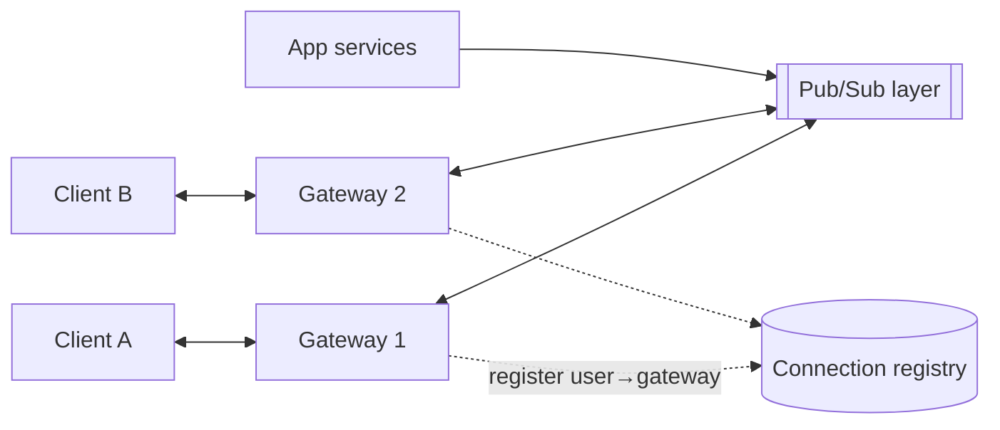

# 06 · Real-Time Systems: WebSockets & Pub/Sub

Chat messages, live scores, collaborative cursors, ride tracking, trading dashboards —
all need the server to push updates to clients as they happen. HTTP's request-response
model is client-initiated, so real-time systems need either a way to simulate push or a
persistent connection. The hard parts are not the protocol; they are holding millions of
connections, routing a message to the right one, and recovering gracefully when
connections drop (which, on mobile networks, is constantly).

## Four ways to push

| Technique | How | Latency | Cost / complexity |
|---|---|---|---|
| Short polling | Client asks every N seconds | Up to N seconds | Wasteful: most responses are empty |
| Long polling | Server holds the request until data arrives or timeout | Near real time | One request per message; reconnect overhead |
| Server-Sent Events (SSE) | One long-lived HTTP response streaming events | Real time, server→client only | Simple, works with HTTP infrastructure, auto-reconnect with last event ID |
| WebSockets | Upgraded persistent, bidirectional connection | Real time, both directions | Stateful connections; needs L7 support for upgrades and sticky routing |

Choose the simplest one that fits. A notifications badge updating every 30 seconds is fine
with polling. A live-score page (server → client only) is a natural fit for SSE. Chat,
games, and collaborative editing — frequent messages in both directions — suit WebSockets.

## The architecture: gateways plus pub/sub

Persistent connections make the connection tier **stateful**: user 42's socket lives on one
specific gateway server. Something must route "deliver to user 42" to that server.



- **Gateways** do nothing but hold connections, authenticate, and relay frames. Keeping
  them thin lets each hold a very large number of mostly idle connections.
- **Business logic** lives in ordinary stateless services.
- **Routing**, two common options:
  1. **Registry**: a store mapping `user_id → gateway_id`. To deliver, look up the gateway
     and send to it directly.
  2. **Topic subscription**: each gateway subscribes to pub/sub channels for the users (or
     rooms) connected to it; publishers publish to `user:42` or `room:7` and the pub/sub
     layer delivers to subscribed gateways.

## Worked example: a WebSocket-free pub/sub fan-out model

The core routing logic is independent of the wire protocol. This model shows rooms,
multiple gateways, and per-connection delivery — and why a message sent while someone is
disconnected needs a separate path.

```python
# pubsub_model.py — gateways subscribe to room topics; publishers never see sockets
from collections import defaultdict

class PubSub:
    def __init__(self):
        self.subs = defaultdict(set)              # topic -> gateways
    def subscribe(self, topic, gw):   self.subs[topic].add(gw)
    def unsubscribe(self, topic, gw): self.subs[topic].discard(gw)
    def publish(self, topic, msg):
        for gw in list(self.subs[topic]):
            gw.deliver(topic, msg)

class Gateway:
    def __init__(self, name, bus):
        self.name, self.bus = name, bus
        self.conns = defaultdict(set)             # topic -> local user ids
        self.inbox = defaultdict(list)            # user -> frames "sent" on the socket
    def join(self, user, room):
        if not self.conns[room]:
            self.bus.subscribe(room, self)        # first local member: subscribe once
        self.conns[room].add(user)
    def leave(self, user, room):
        self.conns[room].discard(user)
        if not self.conns[room]:
            self.bus.unsubscribe(room, self)
    def deliver(self, topic, msg):
        for user in self.conns[topic]:
            self.inbox[user].append(msg)

bus = PubSub()
g1, g2 = Gateway("g1", bus), Gateway("g2", bus)
g1.join("ana", "room:7"); g1.join("ben", "room:7"); g2.join("cy", "room:7")

bus.publish("room:7", {"from": "ana", "text": "hi all", "seq": 1})
g2.leave("cy", "room:7")                          # cy's phone loses signal
bus.publish("room:7", {"from": "ben", "text": "cy?", "seq": 2})

print({u: [m["seq"] for m in g1.inbox[u]] for u in ["ana", "ben"]})  # both got 1 and 2
print({"cy": [m["seq"] for m in g2.inbox["cy"]]})                     # only 1
```

Note two design points. First, a gateway subscribes to a room **once**, no matter how many
local members it has — so a message to a 10,000-member room crosses the pub/sub layer once
per gateway, not once per member. Second, pub/sub is **fire-and-forget**: `cy` missed
message 2. Real-time delivery is an optimization; durable delivery needs a store plus a
catch-up protocol.

## Reconnection and catch-up

Clients disconnect all the time. A robust protocol:

1. Every message has a per-conversation (or per-stream) **sequence number**, assigned when
   it is durably stored.
2. The client remembers the last sequence it has seen.
3. On reconnect, it asks for everything after that sequence (SSE's `Last-Event-ID` is a
   built-in version of this), fetched from the durable store; then live delivery resumes.
4. Clients deduplicate by sequence/message ID, since catch-up and live delivery may overlap.

## Presence

"Online" indicators look trivial and are expensive at scale: every status change could fan
out to every friend. Typical techniques:

- **Heartbeats with TTLs**: the gateway refreshes `presence:user42` with a short TTL; no
  refresh means offline. No explicit "went offline" message is needed for crashes.
- **Lazy fetch**: fetch presence for the users currently visible on screen rather than
  pushing every change to everyone.
- **Debounce**: ignore flaps shorter than a few seconds.

## Operational concerns

- **Load balancing**: WebSocket upgrades need an L7 balancer that supports them; once
  established, a connection stays on its gateway. Balance on new connections, and watch
  for imbalance after deploys.
- **Deploys**: restarting a gateway drops all its connections, and they all reconnect at
  once. Drain gradually and make clients reconnect with **randomized backoff** to avoid a
  thundering herd.
- **Idle timeouts** in proxies close quiet connections; send periodic pings.
- **Back-pressure**: a slow client cannot be allowed to make the gateway buffer unbounded
  data — cap per-connection buffers and drop or disconnect.

## How It Actually Works

A WebSocket starts life as an HTTP/1.1 request with `Upgrade: websocket` and a random key
header. The server replies `101 Switching Protocols` with a hash derived from that key,
proving it understood the handshake. From then on, the same TCP connection carries
WebSocket **frames** — small headers indicating type (text, binary, ping, pong, close) and
length — in both directions, with no per-message HTTP overhead. Client-to-server frames are
masked with a random key, a measure designed to stop the protocol from being abused to
poison intermediary caches.

A gateway can hold many connections because an idle connection costs only a socket and
some buffers, and an event loop (epoll/kqueue-style readiness notification) lets one
thread watch a huge number of sockets and act only on the few with data ready. The
practical limits are memory per connection, file-descriptor limits, and the CPU spent on
TLS and heartbeats — which is why gateways are kept free of business logic.

## Common mistakes

- **Treating pub/sub delivery as durable.** Store first, then publish; recover with
  sequence-based catch-up.
- **Business logic in the gateways**, making them heavy and hard to deploy.
- **Synchronized reconnect storms** after a deploy or network blip.
- **Pushing every presence change to every contact.**
- **WebSockets where SSE or polling would do**, adding stateful infrastructure for
  one-way, low-frequency updates.

## Exercise

1. Extend `pubsub_model.py` with a durable per-room message log and a `reconnect(user,
   last_seq)` that replays missed messages, then resumes live delivery without duplicates.
2. Estimate gateway count for 5M concurrent connections if one gateway comfortably holds
   100,000 (state this as an assumption), with capacity to lose one availability zone of
   three.
3. Design live tracking of a delivery courier's position (updates every 3 seconds, viewed by
   one customer). Which push technique, and why? What happens when the customer's app is in
   the background?
