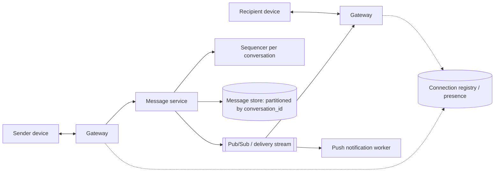

# 10 · Project — Design a Chat System

Chat combines nearly every Level 3 topic: persistent connections, pub/sub, ordering,
idempotency, durable storage, and failure recovery on flaky mobile networks. Design it
yourself first (45–60 minutes), then compare.

## Requirements

**Functional**

- One-to-one and group conversations (groups up to, say, 500 members).
- Send text messages; media via object storage references.
- Real-time delivery to online recipients; offline recipients get messages on reconnect
  and via push notification.
- Message history, synced across a user's devices.
- Delivery and read receipts; online presence (best-effort).

**Non-functional**

- Messages, once acknowledged to the sender, are never lost.
- Within a conversation, every participant sees messages in the **same order**.
- No duplicates visible to users despite retries.
- Low latency for online delivery (target: well under a second end to end within a
  region).

**Out of scope**: end-to-end encryption protocol details (discussed briefly), voice and
video calls, search.

## Estimates

!!! note
    Illustrative assumptions for practising the arithmetic.

```text
DAU 100M; each sends 40 messages/day      → 4B messages/day ≈ 40,000/s avg, ~120,000/s peak
Average group fan-out ~3 recipients        → ~120,000 deliveries/s avg
Message ~300 bytes with metadata           → ~1.2 TB/day, ~440 TB/year before replication
Concurrent connections: maybe 30% of DAU   → ~30M persistent connections at peak
```

The connection count and write rate are the scaling drivers; storage is large but grows
linearly and is append-heavy.

## High-level design



**Send path**

1. The client creates a `client_msg_id` (UUID) and sends the message over its WebSocket.
2. The gateway forwards to the message service.
3. The message service assigns the next **sequence number** for the conversation, writes
   the message to the store keyed by `(conversation_id, seq)`, with a uniqueness constraint
   on `(conversation_id, client_msg_id)` for dedup.
4. Only after the durable write does it acknowledge the sender (`seq` returned) and
   publish the message for delivery.
5. For each recipient: if connected, their gateway pushes it; if not, a push notification
   is sent and the message waits in the store.

**Receive/sync path**

Each device stores `last_seq` per conversation. On connect, it requests all messages with
`seq > last_seq` for its conversations (or an "inbox" summary of which conversations have
new messages), then receives live messages. Duplicates between catch-up and live delivery
are dropped client-side by `seq`.

## Deep dive: ordering

"Same order for everyone" is achieved by having a single authority assign sequence numbers
per conversation. Options:

- **Database-assigned**: store the conversation's `next_seq` in a row and increment it in the
  same transaction as the insert. Simple; each conversation's writes serialize on one row,
  which is fine because a single conversation's message rate is modest.
- **Partition leader**: route all writes for a conversation to the owner of its partition
  (e.g. via consistent hashing), which assigns sequence numbers in memory and persists them.

Client timestamps are **not** used for ordering — device clocks disagree. They can be
shown in the UI, but order is the server's `seq`.

## Deep dive: delivery guarantees

The pipeline is at-least-once at every hop: the client resends if it gets no ack; the
server republishes if a gateway does not confirm; the device re-requests on reconnect.
Exactly-once *display* comes from idempotency:

```python
# chat_core.py — per-conversation sequencing with client-id dedup, plus device sync
import uuid
from collections import defaultdict

class MessageStore:
    def __init__(self):
        self.next_seq = defaultdict(lambda: 1)
        self.messages = defaultdict(list)                  # conv -> [(seq, msg)]
        self.by_client_id = {}                             # (conv, client_id) -> seq

    def append(self, conv, client_msg_id, sender, text):
        key = (conv, client_msg_id)
        if key in self.by_client_id:                       # retried send: same result
            return self.by_client_id[key], False
        seq = self.next_seq[conv]
        self.next_seq[conv] += 1
        self.messages[conv].append((seq, {"from": sender, "text": text}))
        self.by_client_id[key] = seq
        return seq, True

    def since(self, conv, last_seq):
        return [(s, m) for s, m in self.messages[conv] if s > last_seq]

class Device:
    def __init__(self):
        self.last_seq, self.shown = defaultdict(int), defaultdict(list)
    def receive(self, conv, seq, msg):
        if seq <= self.last_seq[conv]:
            return                                          # duplicate: ignore
        if seq != self.last_seq[conv] + 1:
            return "gap"                                    # must sync before showing
        self.shown[conv].append(msg["text"])
        self.last_seq[conv] = seq

store = MessageStore()
conv = "c:ana-ben"
cid = str(uuid.uuid4())
print(store.append(conv, cid, "ana", "lunch?"))   # (1, True)
print(store.append(conv, cid, "ana", "lunch?"))   # (1, False) — client retry, no dup
store.append(conv, str(uuid.uuid4()), "ben", "sure")
store.append(conv, str(uuid.uuid4()), "ana", "12:30")

phone = Device()
phone.receive(conv, 1, {"text": "lunch?"})
print(phone.receive(conv, 3, {"text": "12:30"}))  # 'gap' — seq 2 was missed live
for seq, msg in store.since(conv, phone.last_seq[conv]):     # catch-up sync
    phone.receive(conv, seq, msg)
phone.receive(conv, 3, {"text": "12:30"})         # late live copy: ignored as duplicate
print(phone.shown[conv])                          # ['lunch?', 'sure', '12:30']
```

Sequence numbers do double duty: they order messages and let devices detect gaps (a jump
from 1 to 3 means "sync before displaying").

## Deep dive: storage

- Partition by `conversation_id`; cluster by `seq` so "latest 50 messages" and "messages
  after seq N" are sequential reads. A wide-column store fits this access pattern well; a
  sharded relational database also works.
- Hot recent messages are read far more than old ones; consider tiering old history to
  cheaper storage.
- Media: upload to object storage via presigned URL (Level 2, lesson 9); the message holds
  the reference.

## Deep dive: groups

For a 500-member group, one message means up to 500 deliveries. Store the message
**once** in the conversation; fan out only lightweight notifications to members' gateways
(via topic subscriptions, as in lesson 6). Each device syncs from the shared conversation
log. For very large broadcast channels (tens of thousands of members), switch to pull:
clients fetch when they open the channel, and only notification counts are pushed.

## Receipts and presence

- **Delivered**: device acks `seq` → store per-member `delivered_seq` for the conversation.
- **Read**: similarly `read_seq`. Storing a high-water mark per member per conversation is
  far cheaper than a flag per message.
- **Presence**: heartbeat with TTL; fetch lazily for visible contacts (lesson 6).

## Failure modes

- **Gateway crash**: its devices reconnect elsewhere (with jittered backoff) and sync by
  `last_seq`; nothing is lost because messages were stored before delivery.
- **Message service crash after write, before ack**: the client retries with the same
  `client_msg_id`; dedup returns the existing `seq`.
- **Pub/sub message loss**: devices detect gaps and sync.
- **Region failure**: covered in Level 4's multi-region lesson; conversations have a home
  region, and failover trades a small window of possibly unreplicated messages against
  availability.

## A note on end-to-end encryption

With end-to-end encryption, servers store and route ciphertext they cannot read. The
architecture above still applies — sequencing, dedup, sync, and fan-out work on opaque
payloads — but server-side features that inspect content (search, previews, spam filtering
by content) must move to devices or be redesigned. Key management across multiple devices
and group membership changes is a substantial design problem of its own.

## How It Actually Works

The design's correctness rests on one ordering: **persist, then acknowledge, then
deliver**. Because the sender only sees an ack after the durable write, an acknowledged
message cannot be lost by any later failure. Because delivery happens after persistence,
any recipient who misses a live delivery can always recover it from the store. And because
every hop retries, availability failures turn into delays rather than losses. The sequence
number is the glue: a single per-conversation counter gives a total order that all devices
agree on, a cheap dedup key, a gap detector, and a compact read-receipt representation.

## Common mistakes

- **Delivering before persisting**, so a crash loses acknowledged messages.
- **Ordering by client timestamps.**
- **No client message ID**, making retries produce duplicates.
- **Fanning out full message copies** to every group member's inbox.
- **Per-message read flags** instead of per-member high-water marks.

## Exercise

1. Extend `chat_core.py` with multiple devices per user and a `read_seq` per member; show
   that reading on one device updates the unread count on the other.
2. Estimate storage for 5 years of history with 3 replicas and decide on a tiering policy.
3. Design the "inbox" API that tells a reconnecting device which of its 300 conversations
   have new messages without querying all 300.
4. Write a design doc for your chat system with a failure-mode table: component, failure,
   user-visible effect, recovery mechanism.
