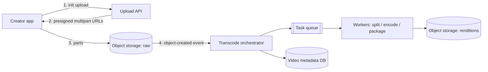

# 01 · Case Study: Video Streaming

This is a reasoning exercise: we derive a generic design for a video-on-demand platform
from requirements. It is not a description of any specific company's internal system.
Large streaming services have published some material about their approaches over the
years, but details change and much is private, so treat the design below as one sound
option among several.

## Requirements

**Functional**: creators upload videos; viewers browse and play them on phones, laptops,
and TVs over varying networks; playback supports seeking; basic view counts.

**Non-functional**

- Playback start should be fast (a couple of seconds) and rebuffering rare.
- Very read-heavy: each video uploaded once, watched many times — with extreme skew.
- Uploads can take minutes to become playable; that is acceptable.
- Cost matters enormously: bandwidth and storage dominate.

## Estimates

!!! note
    Rough, assumption-driven arithmetic.

```text
Uploads: 500,000 videos/day, average 10 min, source ~1 GB each  → ~500 TB/day of source
Renditions: ~6 resolutions/bitrates; outputs perhaps ~1–2× source size in total
Viewing: 50M daily viewers × 60 min at an average ~3 Mbit/s
  → 50M × 3,600 s × 3 Mbit/s ≈ 5.4 × 10^14 bit/day ÷ 8 ≈ 68 PB/day of egress
  → average ≈ 68 PB / 86,400 s ≈ 790 GB/s ≈ 6 Tbit/s (peaks several times higher)
```

Conclusion: egress dwarfs everything. The design must deliver almost all bytes from caches
close to viewers, and must keep bitrates efficient. Storage of renditions is next; compute
for transcoding is significant but schedulable.

## Upload path



- **Resumable multipart uploads** directly to object storage (Level 2, lesson 9). A
  metadata row tracks state: `uploading → processing → ready | failed`.
- **Validate** the file (container, duration, codec) before spending compute on it.

## Transcoding as a DAG

Encoding a 10-minute video into six renditions sequentially is slow. A common technique is
to **split the source into segments** (e.g. a few seconds each, cut at keyframes), encode
segments in parallel across many workers, then **stitch** and **package**:

```text
validate → split into N chunks → [encode chunk_i × rendition_j] (parallel) →
  assemble per rendition → package (HLS/DASH manifests + segments) →
  thumbnails, captions → publish (metadata → ready)
```

The orchestrator is a workflow engine (Level 3, lesson 2's orchestration idea): each task
is idempotent (outputs written to deterministic keys), retries on failure, and the whole
DAG can resume after a crash. Workers are stateless and autoscale on queue depth; many
platforms can run encoding on cheaper interruptible/spot capacity because a killed task is
simply retried.

## Adaptive bitrate (ABR) playback

Videos are served as many small segments (typically a few seconds each) in several
renditions, described by a manifest (HLS `.m3u8` or DASH `.mpd`).

```text
master manifest
 ├─ 240p  @ 0.4 Mbit/s → seg_0001.m4s, seg_0002.m4s, …
 ├─ 480p  @ 1.2 Mbit/s → …
 ├─ 720p  @ 3.0 Mbit/s → …
 └─ 1080p @ 6.0 Mbit/s → …
```

The **player** measures download throughput and buffer level, and picks the rendition for
each next segment. Network drops? The next segment comes from a lower rung; no restart is
needed. This client-side logic is what makes playback robust, and it means the server side
is just static file delivery — which CDNs do extremely well.

## Worked example: a simple ABR decision

```python
# abr.py — buffer- and throughput-aware rendition choice for the next segment
LADDER = [(240, 0.4), (480, 1.2), (720, 3.0), (1080, 6.0)]   # (height, Mbit/s)

def choose(throughput_mbps, buffer_s, safety=0.8, low_buffer_s=6):
    budget = throughput_mbps * safety
    if buffer_s < low_buffer_s:          # nearly empty buffer: be conservative
        budget *= 0.5
    best = LADDER[0]
    for rung in LADDER:
        if rung[1] <= budget:
            best = rung
    return best[0]

samples = [(8.0, 20), (8.0, 4), (2.5, 15), (0.6, 3), (15.0, 30)]
for tput, buf in samples:
    print(f"throughput {tput:>4} Mbit/s, buffer {buf:>2}s -> {choose(tput, buf)}p")
```

Real players use more elaborate controllers (smoothing throughput estimates, preferring
stability over frequent switches), but the principle is the same: stay under measured
bandwidth with a safety margin, and protect the buffer.

## Delivery

- Segments and manifests are immutable once published → perfect CDN objects with long
  TTLs (Level 1, lesson 8).
- Popularity is heavily skewed: a small fraction of titles accounts for most viewing.
  Popular content stays hot in edge caches; the long tail is fetched from regional
  tiers or origin on demand.
- Some very large streaming providers have publicly described placing their own caching
  appliances inside internet service provider networks to cut transit costs. That is an
  option only at very large scale; most platforms use commercial CDNs, often more than one.
- **Pre-positioning**: for predictable spikes (a new season release), push content to edges
  before it is requested.

## Metadata, views, and playback APIs

- Metadata (titles, owners, rendition lists, state) in a replicated database; small and
  read-heavy → cache aggressively.
- **Playback API** returns a manifest URL (often signed, with expiry, for access control)
  and the chosen CDN host.
- **View counts and watch-time** come from player heartbeat events → a streaming pipeline →
  aggregated counters (the batching patterns from Level 3, lesson 9). Counts lag by seconds
  or minutes; that is fine.

## How It Actually Works

Segmenting is what makes the whole system scale. A continuous video becomes thousands of
independent, immutable, small HTTP objects. Each segment begins with a keyframe (an
independently decodable frame), so a player can start or switch rendition at any segment
boundary. Immutability lets every cache layer keep segments without invalidation logic.
Small size lets delivery use ordinary HTTP caching and range semantics. Independence lets
encoding parallelize by segment and lets the client adapt quality segment by segment.

Transcoding costs scale with (duration × renditions × encoding complexity). More efficient
codecs reduce bitrate for the same perceived quality — which directly reduces the dominant
cost, egress — but take more compute to encode and require device support. A typical
trade-off is to encode everything in a widely supported codec and additionally encode
popular titles in a more efficient one, because the extra encoding compute pays for itself
only when multiplied by many views.

## Common mistakes

- **Streaming whole files** instead of segmented adaptive bitrate.
- **Proxying video through app servers.**
- **Sequential transcoding** of long videos on a single machine.
- **Mutable segment URLs**, breaking CDN caching.
- **Ignoring egress cost** in the estimates, where it is usually the largest line item.

## Exercise

1. Run `abr.py` and extend it with a rule that avoids switching more than one rung per
   segment. Why might users prefer this?
2. Estimate storage for one year of uploads using the assumptions above, with renditions
   totaling 1.5× source and the raw source deleted after 30 days. Then reconsider: should
   the raw source be kept (for re-encoding with future codecs)? Price the trade-off in
   terabytes.
3. Design the live-streaming variant (a creator broadcasts in real time). Which parts of
   this design change, and what latency does segment length impose?
