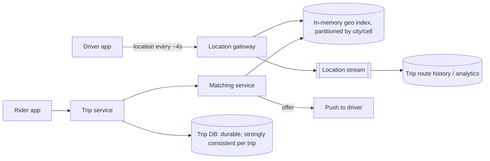

# 02 · Case Study: Ride-Hailing Dispatch

A reasoning exercise: design the core of a ride-hailing service — tracking drivers,
finding nearby ones, and assigning a driver to a rider — from requirements. This is a
generic design, not a description of any particular company's system; public engineering
talks and posts exist from companies in this space, but architectures evolve and details
vary, so we reason from first principles.

## Requirements

**Functional**

- Drivers' apps report location every few seconds while online.
- A rider requests a ride from a pickup point; the system offers it to a suitable nearby
  driver, who accepts or declines.
- Both parties see each other's live location during pickup and the trip.
- Trip lifecycle: requested → offered → accepted → arrived → in progress → completed /
  cancelled.

**Non-functional**

- Matching within a few seconds.
- **A driver is never assigned to two trips at once**, and a trip never gets two drivers.
- Location data is high-volume and ephemeral; trip records are durable and financial.
- Operates per city/region; most interactions are local.

## Estimates

!!! note
    Assumed figures for practice.

```text
Online drivers at peak (whole platform): 1M; update every 4 s → 250,000 location writes/s
Each update ~100 bytes                  → 25 MB/s ingest (tiny in bytes, large in ops)
Ride requests at peak: 5,000/s; each triggers a nearby search
```

Key insight: location updates are many small **writes that overwrite each other** — only
the latest position per driver matters for matching. That suggests an in-memory store, not
a durable database write per update.

## Components



## Geospatial indexing

"Find drivers within 2 km of this point" cannot be a scan of a million drivers. Approaches:

- **Geohash**: encode latitude/longitude into a string where a shared prefix means spatial
  proximity. Nearby search = look up the point's cell and its neighbours.
- **Hierarchical cell systems** such as Google's S2 (squares projected on a cube) or Uber's
  open-source H3 (hexagons) serve the same purpose with better-behaved cell shapes;
  hexagons have uniform neighbour distances, which is convenient for proximity.
- **Quadtrees / R-trees**: tree indexes that adapt to density.

With cells, the index is simply `cell_id → set of driver IDs`, plus `driver_id → (cell,
position, status, updated_at)`. An update moves a driver between cells if needed.

## Worked example: a grid-cell index and nearest-driver search

```python
# geo_index.py — uniform grid cells (a simplified geohash) with ring search
import math
from collections import defaultdict

CELL_DEG = 0.01            # ~1.1 km of latitude per cell; longitude cells shrink with latitude

def cell_of(lat, lng):
    return (math.floor(lat / CELL_DEG), math.floor(lng / CELL_DEG))

def haversine_km(a, b):
    lat1, lng1, lat2, lng2 = map(math.radians, (*a, *b))
    h = (math.sin((lat2 - lat1) / 2) ** 2 +
         math.cos(lat1) * math.cos(lat2) * math.sin((lng2 - lng1) / 2) ** 2)
    return 2 * 6371 * math.asin(math.sqrt(h))

class GeoIndex:
    def __init__(self):
        self.cells = defaultdict(set)
        self.drivers = {}                       # id -> (pos, cell, available)

    def update(self, driver, lat, lng, available=True):
        old = self.drivers.get(driver)
        new_cell = cell_of(lat, lng)
        if old and old[1] != new_cell:
            self.cells[old[1]].discard(driver)
        self.cells[new_cell].add(driver)
        self.drivers[driver] = ((lat, lng), new_cell, available)

    def nearest(self, lat, lng, k=3, max_rings=3):
        cx, cy = cell_of(lat, lng)
        found = []
        for r in range(max_rings + 1):          # expand ring by ring
            for dx in range(-r, r + 1):
                for dy in range(-r, r + 1):
                    if max(abs(dx), abs(dy)) != r:
                        continue                # only the new ring's cells
                    for d in self.cells.get((cx + dx, cy + dy), ()):
                        pos, _, avail = self.drivers[d]
                        if avail:
                            found.append((haversine_km((lat, lng), pos), d))
            if len(found) >= k:
                break                           # note: see exercise about correctness
        return sorted(found)[:k]

idx = GeoIndex()
idx.update("d1", 12.9716, 77.5946)
idx.update("d2", 12.9750, 77.5990)
idx.update("d3", 12.9900, 77.6200)
idx.update("d4", 12.9720, 77.5950, available=False)     # on a trip
for dist, d in idx.nearest(12.9720, 77.5950):
    print(f"{d}: {dist:.2f} km")
```

Real systems rank candidates by estimated time of arrival over the road network, not
straight-line distance — a driver across a river may be close in kilometres and far in
minutes. The index narrows the candidate set; an ETA service ranks it.

## Matching and the "never double-assign" rule

Matching is where correctness matters. Two riders' requests may pick the same nearby
driver concurrently. The assignment must be an atomic conditional update:

```sql
UPDATE drivers SET status = 'offered', trip_id = :trip
WHERE driver_id = :driver AND status = 'available';
-- 1 row updated → offer succeeded; 0 rows → someone else got this driver, try next
```

Equivalently, a compare-and-set in whichever store holds driver status, or routing all
matching for a city (or cell region) through a single-threaded matcher per partition, which
serializes decisions without locks. The offer has a timeout; if the driver does not accept
within it, the driver returns to `available` and the matcher moves on.

Beyond greedy nearest-driver matching, dispatch systems may **batch** requests over a short
window and solve an assignment problem that minimizes total pickup time across many riders
and drivers — a quality-vs-latency trade-off.

## Trip state machine

Trips move through explicit states with allowed transitions only. Each transition is a
conditional update (`… WHERE trip_id = ? AND state = 'accepted'`), making them idempotent
and race-safe: a duplicate "arrived" event from a flaky phone does nothing the second time.
Trip records are durable and later feed payments (next-but-one lesson).

## Partitioning by geography

Almost all queries are local, so partition matching and location indexes **by city or
region**. Each partition is independent; a failure in one city's matcher does not affect
another. Boundary effects (a rider near a partition edge) are handled by querying
neighbouring cells across the boundary or by overlapping partitions.

## How It Actually Works

The geospatial index works because cell IDs turn a two-dimensional proximity question into
one-dimensional key lookups. Converting a coordinate to a cell is a constant-time
computation; finding candidates is a handful of hash lookups for the cell and its
neighbours; and the expensive distance or ETA computation runs only on those candidates.
Hierarchical systems (geohash, S2, H3) add a second trick: a cell ID at a coarser level is a
prefix or parent of finer IDs, so the same index can answer "within 500 m" and "within
5 km" by choosing the resolution.

Location updates avoid durable writes because they are **idempotent overwrites of soft
state**. If the in-memory index loses a driver's position, the next update 4 seconds later
restores it. Durability is spent where it matters — trip state and money — while the
high-volume path tolerates loss by design.

## Common mistakes

- **Writing every location update to a relational database.**
- **Straight-line distance as the final ranking.**
- **Non-atomic assignment**, allowing double-booked drivers.
- **One global matcher** instead of geographic partitions.
- **Grid search that stops too early**: a driver in the next ring can be closer than one
  found in the current ring's corner.

## Exercise

1. The `nearest` function stops as soon as it has *k* candidates. Construct a case where it
   returns a farther driver while a nearer one sits in the next ring, then fix it (hint:
   search one extra ring after reaching *k*).
2. Implement a `try_assign(driver, trip)` compare-and-set and simulate two concurrent
   requests racing for the same driver.
3. Design surge-period behavior: requests exceed drivers 3:1 in one area. What does the
   matcher do, what does the rider see, and which parts of the system receive extra load?
