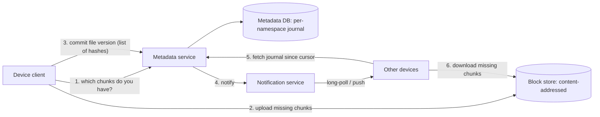

# 03 · Case Study: Distributed File Storage

A reasoning exercise: design a file storage and sync service — users keep a folder on
several devices, and the service stores files durably and keeps every device in sync.
The design is generic; it does not describe the internals of any specific product.

## Requirements

**Functional**

- Upload, download, rename, move, and delete files and folders.
- Changes on one device appear on the user's other devices within seconds to minutes.
- Version history for recovering previous versions and deleted files.
- Sharing folders with other users.

**Non-functional**

- Never lose or corrupt a committed file.
- Efficient with bandwidth: editing a small part of a large file should not re-upload it.
- Works offline; syncs when reconnected; handles concurrent edits sanely.

## Estimates

!!! note
    Illustrative assumptions.

```text
Users: 50M; average stored 20 GB   → 1 EB logical (before dedup and redundancy)
Daily changed data: ~1% of stored  → ~10 PB/day of changes, much of it small edits
Files per user: ~20,000             → 10^12 file entries of metadata
```

Two very different stores emerge: a massive **block store** for bytes, and a metadata
store with around a trillion small entries that must be strongly consistent per user or
namespace.

## Core idea: files are lists of chunks

Split each file into chunks, identify each chunk by a cryptographic hash of its content,
and store chunks in a content-addressed block store. A file version is then just an
ordered list of chunk hashes.

```text
report.docx v7 = [h(a1f3…), h(09bc…), h(77de…)]
report.docx v8 = [h(a1f3…), h(5e21…), h(77de…)]   ← only the middle chunk changed
```

Benefits:

- **Delta sync**: upload only chunks the server does not already have.
- **Deduplication**: identical chunks — across versions, files, or users — are stored once.
- **Integrity**: a chunk's hash verifies its content on every read.
- **Parallelism and resumability**: chunks upload independently.

## Fixed-size vs content-defined chunking

Fixed-size chunks (every 4 MB) break down when bytes are *inserted*: everything after the
insertion shifts, every later chunk changes, and dedup is lost. **Content-defined chunking
(CDC)** picks boundaries where a rolling hash of the last few bytes matches a pattern, so
boundaries move *with* the content; an insertion changes only nearby chunks.

## Worked example: fixed vs content-defined chunking

```python
# chunking.py — why content-defined chunking survives insertions
import hashlib, random

def fixed_chunks(data, size=64):
    return [data[i:i + size] for i in range(0, len(data), size)]

def cdc_chunks(data, window=16, mask=0x3F, min_size=16):
    """Cut where a hash of the last `window` bytes has its low bits all zero
    (average chunk ≈ mask+1 bytes). Recomputed per position for clarity;
    real systems use an O(1) rolling hash such as Rabin or Gear."""
    chunks, start = [], 0
    for i in range(window, len(data)):
        h = int.from_bytes(hashlib.blake2b(data[i - window:i], digest_size=4).digest(), "big")
        if i - start >= min_size and (h & mask) == 0:
            chunks.append(data[start:i])
            start = i
    chunks.append(data[start:])
    return chunks

def reuse(old, new):
    old_ids = {hashlib.sha256(c).hexdigest() for c in old}
    return sum(hashlib.sha256(c).hexdigest() in old_ids for c in new) / len(new)

rng = random.Random(8)
original = bytes(rng.randrange(256) for _ in range(20_000))
edited = original[:5_000] + b"INSERTED A FEW BYTES" + original[5_000:]

print(f"fixed-size chunks reused after insert: {reuse(fixed_chunks(original), fixed_chunks(edited)):.0%}")
print(f"content-defined chunks reused:         {reuse(cdc_chunks(original), cdc_chunks(edited)):.0%}")
```

Fixed-size chunking reuses only the chunks before the insertion (about a quarter here);
content-defined chunking reuses nearly all of them, because boundaries after the edit
re-synchronize with the content.

## Architecture



**Commit protocol**: upload chunks first, then commit the metadata. The commit is a
conditional write: "set file X to version v8 = [hashes], *if* its current version is v7".
If the chunks are not all present, the commit is rejected with the missing list. Because
chunks are immutable and addressed by hash, retries are naturally idempotent.

**Metadata journal**: each namespace (a user's root, or a shared folder) has an
append-only journal of changes with increasing sequence numbers. Devices keep a cursor
and fetch "changes since cursor N" — the same sequence-and-catch-up pattern as the chat
project in Level 3. A notification service just says "namespace changed; come sync".

**Partitioning**: metadata by namespace ID (all of one user's or one shared folder's
entries together, so a commit is a single-partition transaction). Blocks by hash, which
spreads uniformly.

## Conflicts

Two devices edit the same file offline, then both sync. The first commit (v7 → v8)
succeeds; the second, also based on v7, fails its conditional check. Options:

- **Conflicted copy**: keep both — save the second as "report (Ana's laptop conflicted
  copy).docx". Safe and understandable; the user merges. A common choice for opaque files.
- **Last-writer-wins**: simple, silently loses work — a poor default for documents.
- **Merging**: possible for specific formats (plain text, structured documents), which is
  why collaborative editors use operational transforms or CRDTs instead of whole-file sync.

## Deletion, versions, and garbage collection

Deleting a file writes a tombstone version; old versions remain for the retention period.
Chunks may be shared by many files and users, so a chunk can be removed only when *no*
retained version references it. That requires reference tracking or a periodic
mark-and-sweep over metadata — done carefully, with a grace period, because deleting a
chunk that a concurrent upload is about to reference would corrupt a file.

## Security note on dedup

Cross-user dedup can leak information: if uploading a file completes instantly, the
uploader learns someone else already stored that exact file. Designs mitigate this by
deduplicating only within a user or organization, or by always requiring proof of
possession of the content. With client-side encryption under per-user keys, cross-user
dedup is not possible at all — an explicit privacy/cost trade-off.

## How It Actually Works

Content addressing turns a hard distributed-systems problem into an easy one. Because a
chunk's name *is* the hash of its content, a chunk can never be updated in place — a
different content is a different name. So the block store needs no locking, no
invalidation, and no cache coherence: any replica holding a chunk under a given hash has
the right bytes (and can verify them). All the mutability and concurrency control moves
to the metadata layer, which is small by comparison and can afford strong consistency
through per-namespace transactions and conditional commits.

Content-defined chunking works because boundaries depend only on a local window of bytes.
After an insertion, the rolling hash sees different bytes only while the window overlaps
the edit; once past it, the same byte sequences produce the same hashes and the same
boundaries as before, so the remaining chunks are identical.

## Common mistakes

- **Whole-file upload on every change.**
- **Fixed-size chunks** for data that gets insertions.
- **Committing metadata before chunks are durable**, creating files that point to missing
  data.
- **Last-writer-wins for documents.**
- **Garbage-collecting chunks without a grace period.**

## Exercise

1. Run `chunking.py`, then vary `mask` to change average chunk size. Plot reuse and chunk
   count. What does smaller chunking cost in metadata?
2. Design the sync algorithm for a device that was offline for a month with 3,000 remote
   changes and 200 local ones. In what order do you apply them, and where do conflicts
   surface?
3. Estimate metadata storage for 10¹² file entries at ~200 bytes each plus version history,
   and choose a partitioning scheme.
