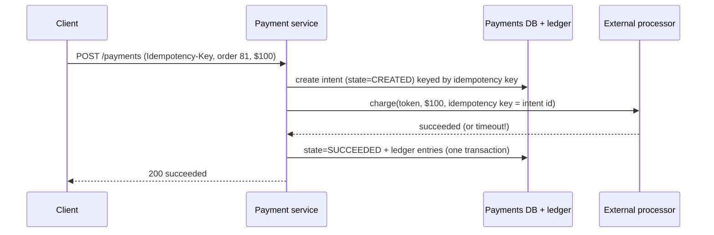

# 04 · Case Study: Payment System

A reasoning exercise: design the payments backend for an online marketplace that charges
buyers by card and pays out sellers. This is a generic design built from principles, not
a description of any particular payment company's internals. It assumes a third-party
**payment processor** handles card networks; the platform integrates with it through an
API. Real payment systems also involve regulation (card data security standards,
financial licensing, local rules), which this lesson mentions but cannot cover fully.

## Requirements

**Functional**: charge a buyer for an order; refund fully or partially; pay out seller
balances periodically; show balances and transaction history.

**Non-functional** — correctness dominates everything:

- **Never charge twice** for one order, never lose track of money.
- Every movement of money is auditable and reconstructable.
- External processor calls can time out with unknown outcomes; the system must converge to
  the truth anyway.
- Throughput is modest compared with social apps; latency matters less than correctness.

## Don't store card numbers

Card data is handled through the processor's hosted fields or SDKs, which return a
**token** representing the card. The platform stores only tokens. This keeps raw card data
out of your systems and drastically reduces your compliance scope. Treat this as a hard
design constraint.

## The ledger: double-entry bookkeeping

Balances are not a column you update. They are the sum of immutable **ledger entries**,
and every transaction writes entries that **sum to zero** across accounts — money moves,
it is never created or destroyed.

```text
Buyer pays $100 for an order (platform fee 10%):
  account                     debit    credit
  processor_receivable         100.00
  seller:42 payable                     90.00
  platform:revenue                      10.00
                               ------   ------
                               100.00   100.00     ← must balance
```

Properties that matter for design:

- **Append-only**: never update or delete entries; corrections are new reversing entries.
- **Integer minor units** (cents) — never floating point.
- **Balanced per transaction**, enforced in the same database transaction that writes the
  entries.
- Balance = sum of entries (with periodic snapshots/materialized balances for speed).

## Payment flow with idempotency



1. **Payment intent** row created first, keyed by the client's idempotency key (Level 3,
   lesson 3) — a retried request finds the existing intent instead of creating another.
2. Call the processor **passing our intent ID as the processor's idempotency key** (major
   processors support this). If we retry the call, the processor returns the original
   result rather than charging again.
3. On success, write state and ledger entries in one local transaction.
4. **On timeout**, the outcome is unknown. Mark the intent `PENDING_UNKNOWN`, and resolve it
   by retrying the idempotent call or querying the processor for the intent's status —
   never by creating a new charge.

## Worked example: a ledger with invariants

```python
# ledger.py — double-entry ledger with idempotent payment intents (SQLite)
import sqlite3

db = sqlite3.connect(":memory:", isolation_level=None)
db.executescript("""
CREATE TABLE intents(idem_key TEXT PRIMARY KEY, order_id TEXT, amount INT, state TEXT);
CREATE TABLE entries(id INTEGER PRIMARY KEY, txn TEXT, account TEXT, amount INT);
""")

def post(txn, lines):
    """lines: (account, signed amount in cents); debits positive, credits negative."""
    if sum(a for _, a in lines) != 0:
        raise ValueError("unbalanced transaction")
    db.executemany("INSERT INTO entries(txn,account,amount) VALUES (?,?,?)",
                   [(txn, acct, amt) for acct, amt in lines])

class FakeProcessor:
    def __init__(self): self.charges = {}
    def charge(self, key, amount):                 # idempotent on key
        self.charges.setdefault(key, amount)
        return "succeeded"

psp = FakeProcessor()

def pay(idem_key, order_id, amount, seller, fee_bps=1000):
    db.execute("BEGIN IMMEDIATE")
    row = db.execute("SELECT state FROM intents WHERE idem_key=?", (idem_key,)).fetchone()
    if row and row[0] == "SUCCEEDED":
        db.execute("COMMIT")
        return "SUCCEEDED (replayed)"
    if not row:
        db.execute("INSERT INTO intents VALUES (?,?,?,'CREATED')", (idem_key, order_id, amount))
    db.execute("COMMIT")

    result = psp.charge(idem_key, amount)          # external call, outside the DB txn

    fee = amount * fee_bps // 10_000
    db.execute("BEGIN IMMEDIATE")
    db.execute("UPDATE intents SET state='SUCCEEDED' WHERE idem_key=?", (idem_key,))
    post(idem_key, [("processor_receivable", amount),
                    (f"seller:{seller}:payable", -(amount - fee)),
                    ("platform:revenue", -fee)])
    db.execute("COMMIT")
    return result.upper()

print(pay("k-81", "order-81", 10_000, seller=42))
print(pay("k-81", "order-81", 10_000, seller=42))      # client retry
print("processor charges:", psp.charges)                # one charge
for acct, bal in db.execute("SELECT account, SUM(amount) FROM entries GROUP BY account"):
    print(f"{acct:22s} {bal / 100:>8.2f}")
print("ledger sums to", db.execute("SELECT SUM(amount) FROM entries").fetchone()[0])
```

Notice the external call sits **between** two local transactions — never inside one.
Holding a database transaction open across a network call to a third party would hold
locks for an unbounded time. The intent's state machine bridges the gap: any crash leaves
an intent in a state from which a recovery job knows what to do.

## Webhooks and asynchronous outcomes

Processors report many outcomes asynchronously (disputes, delayed failures, refunds
completing) via **webhooks**. Webhook handlers must:

- verify the signature (webhooks are forgeable otherwise);
- be idempotent (processors retry deliveries);
- tolerate out-of-order events (use the processor's object state or timestamps, and state
  machine transitions that reject invalid moves).

## Reconciliation

Even with all of the above, the platform's records and the processor's records can
diverge (bugs, missed webhooks, manual operations). **Reconciliation** is a scheduled job
comparing the platform's ledger against the processor's settlement reports and bank
statements, line by line, flagging mismatches for investigation. It is not optional — it is
how a payment system *proves* it is correct, and auditors will ask for it.

## Payouts

Seller payouts batch the `seller:*:payable` balances on a schedule, create payout
intents (again idempotent), call the processor or bank transfer API, and post ledger
entries moving money from payable to paid-out. Holding periods protect against refunds
and disputes arriving after payout.

## How It Actually Works

The design survives failures because it separates **what we intend** from **what we know
happened**. The intent records intention durably before any side effect. The processor
call is made idempotent by reusing the intent ID, so repeating it cannot double-charge.
Ledger entries are written only once the outcome is known, in a local ACID transaction
with an enforced zero-sum invariant. When the network leaves an outcome unknown, the
system does not guess: it re-asks through idempotent operations until it knows. And
reconciliation closes the loop against an independent record of truth. Each layer assumes
the layer below may fail and has a way to converge.

Double-entry bookkeeping is itself an error-detection code centuries older than
computers: because every transaction balances, the whole ledger must sum to zero, and any
bug that writes only one side of a movement shows up immediately as a non-zero total.

## Common mistakes

- **Floating-point money.**
- **Mutable balance columns** without an immutable entry log.
- **Retrying a timed-out charge as a new charge.**
- **External calls inside database transactions.**
- **Unverified, non-idempotent webhook handlers.**
- **No reconciliation**, so discrepancies are discovered by customers or auditors.

## Exercise

1. Run `ledger.py`. Add `refund(idem_key, amount)` that posts reversing entries and
   prevents refunding more than was charged.
2. Simulate a timeout: make `FakeProcessor.charge` record the charge but raise
   `TimeoutError`. Write the recovery job that resolves `CREATED` intents older than one
   minute without double-charging.
3. Write the reconciliation query that compares a processor settlement file (a list of
   `(idem_key, amount)`) to the ledger and reports three categories of mismatch.
